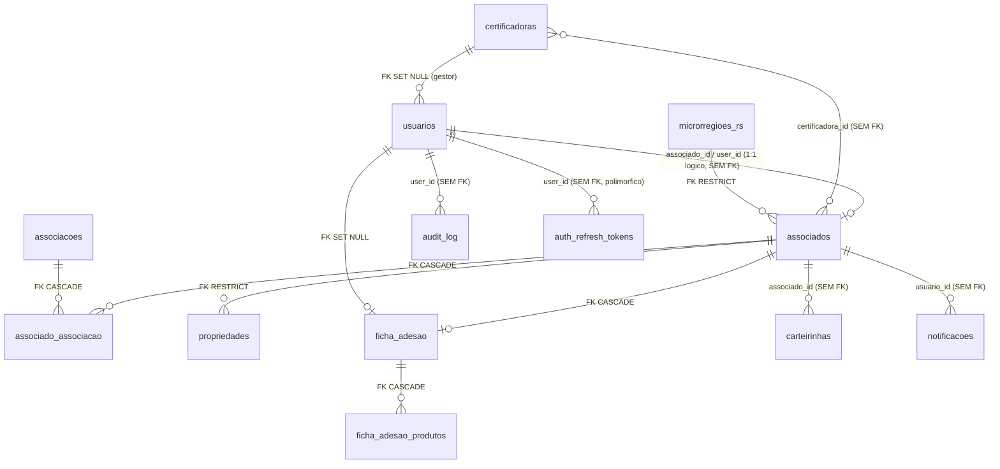
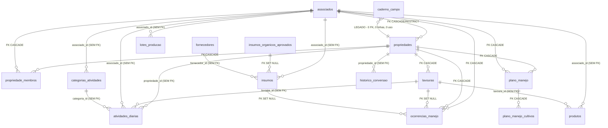
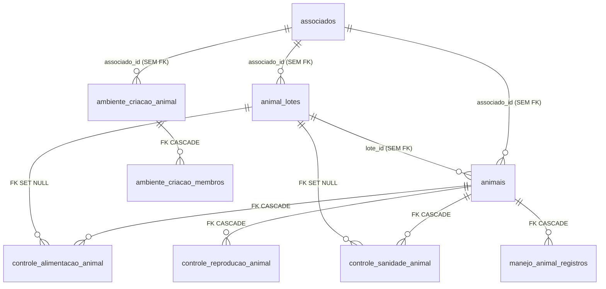
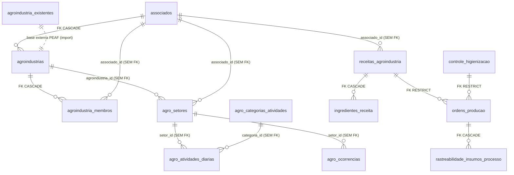
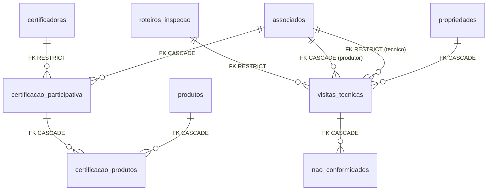
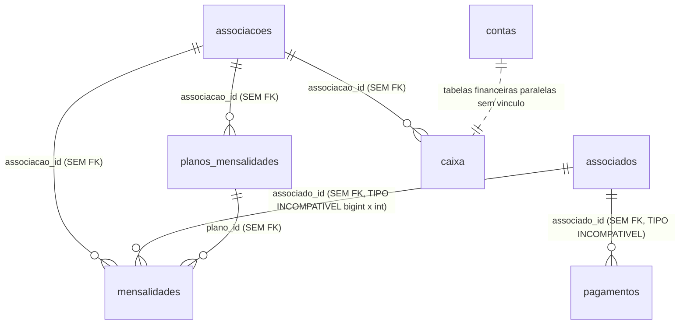
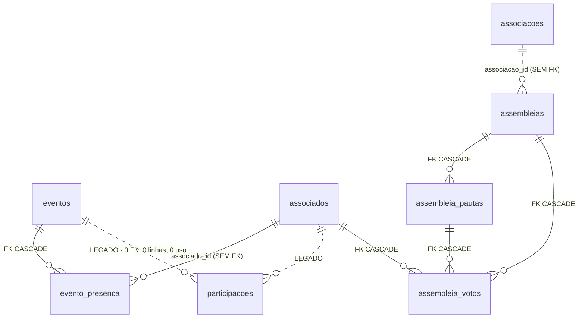

# Mapa Completo do Schema — Banco `sisagro` (SINPORG)

> **Engenharia reversa do schema MySQL/MariaDB legado**
> Workspace: `C:\xampp\htdocs\app` · Banco: `sisagro` · Servidor: **MariaDB 10.4.32-MariaDB** (XAMPP, `localhost`, user `root`)
> Fontes: banco **vivo** (information_schema), `sql/*.sql` (24 scripts) e os dumps `sql/_backup/sisagro_pre_fase0_20260911.sql` (12.8 MB) e `sql/_backup/sisagro_pos_fase0_20260911.sql` (12.8 MB).
> **O banco estava acessível** — todo o inventário, dicionário de dados, ENUMs, índices, FKs e contagens abaixo são **factuais, lidos do servidor vivo**, não inferidos dos dumps.

---

## 0. Sumário executivo

| Métrica | Valor |
|---|---|
| Tabelas base (BASE TABLE) | **77** |
| Views | **1** (`view_caderno_campo_consolidado`) |
| Total de objetos | **78** |
| Colunas (tabelas base) | **996** (+29 na view = 1.025 objetos) |
| Índices distintos (inclui PRIMARY) | **229** |
| Chaves estrangeiras (FKs) | **48** |
| Colunas ENUM/SET | **71** |
| Triggers | **0** |
| Stored procedures / functions | **0** |
| Engine | **100% InnoDB** |
| Collation | **100% `utf8mb4_unicode_ci`** (77/77 tabelas) |
| Tabelas sem nenhuma FK | **45 de 77** |
| Tabelas "ilha" (sem FK de entrada nem de saída) | **33** |
| Tabelas vazias (0 registros) | **8** |
| Maior tabela | `cnpo` (23.232 linhas) · `cidades` (5.595) · `notificacoes` (364) |

**Estado do saneamento (`fase0`):** o dump `pre_fase0` tinha **86 tabelas**; o `pos_fase0` tem **75**; o banco vivo tem **77**. Em 11/09/2026 a Fase 0 removeu 11 tabelas legadas, padronizou collation de 63 tabelas, converteu `cidades` de MyISAM→InnoDB e criou as PRIMARY KEYs que faltavam (`caderno_campo`, `cidades`). Depois disso o banco recebeu **2 tabelas novas** do stack Node/Prisma: `auth_refresh_tokens` e `_prisma_migrations`.

---

## 1. Inventário completo das tabelas

Todas as tabelas são **InnoDB / utf8mb4_unicode_ci**. "PK" indica a chave primária. `reg.` = contagem exata (`COUNT(*)`) lida do banco vivo.

### 1.1 Identidade, acesso e associativismo (11)

| # | Tabela | Propósito inferido | Cols | PK | Reg. |
|---|---|---|---|---|---|
| 1 | `associados` | **Pessoa/associado** — cadastro canônico do quadro associativo (nome, CPF, endereço, situação, certificadora, cluster de comunicação). Tabela central do sistema. | 52 | `id` | 30 |
| 2 | `usuarios` | **Conta de acesso** — credencial de login, `nivel` (1 Admin/2 Gestor/3 Usuário), órgão/setor, bridge JWT do PWA. Espelha dados pessoais do associado. | 42 | `id` | 12 |
| 3 | `associacoes` | Associações/entidades jurídicas (nome, sigla, CNPJ-like, diretoria). 3 registros ativos. | 17 | `id` | 3 |
| 4 | `associado_associacao` | N:N associado↔associação com `tipo_vinculo` (diretoria, conselhos, comissões). | 4 | `associado_id, associacao_id` | 24 |
| 5 | `ficha_adesao` | Ficha de adesão completa (58 colunas) — dados pessoais, propriedade, situação fundiária, sistemas de produção, dados bancários/PIX, workflow de aprovação. | 58 | `id` | 5 |
| 6 | `ficha_adesao_produtos` | Produtos/culturas declarados na ficha de adesão (N:1 com `ficha_adesao`). | 7 | `id` | 11 |
| 7 | `password_resets` | Tokens de recuperação de senha (SHA-256, 60 min). | 6 | `id` | 1 |
| 8 | `auth_refresh_tokens` | Refresh tokens do stack Node/Prisma (hash, user_type usuario/associado, revogação). **Tabela nova pós-Fase 0.** | 9 | `id` | 8 |
| 9 | `carteirinhas` | Carteirinha digital do associado (token opaco + validade). | 5 | `id` | 6 |
| 10 | `notificacoes` | Notificações in-app (associado/sistema), com flag `lida`. | 10 | `id` | 364 |
| 11 | `audit_log` | Trilha de auditoria genérica (`acao`, `tabela`, `registro_id`, IP). | 8 | `id` | 247 |

### 1.2 Propriedade, caderno de campo e produção vegetal (20)

| # | Tabela | Propósito inferido | Cols | PK | Reg. |
|---|---|---|---|---|---|
| 12 | `propriedades` | Propriedades rurais do associado (área, endereço, geo lat/long, imagens). | 21 | `id` | 16 |
| 13 | `propriedade_membros` | N:N associado↔propriedade (copropriedade/titularidade compartilhada). | 6 | `id` | 16 |
| 14 | `lavouras` | Talhões/lavouras dentro da propriedade (cultura, área, plantio, colheita). | 11 | `id` | 8 |
| 15 | `atividades_diarias` | **Caderno de campo efetivo** — atividades diárias (data, horas, tipo, insumo, status, imagem, observações). Alvo de `view_caderno_campo_consolidado`. | 21 | `id` | 11 |
| 16 | `categorias_atividades` | Categorias de atividade do caderno de campo (nome, cor). | 6 | `id` | 7 |
| 17 | `culturas` | Catálogo de culturas (ciclo, época de plantio). **Vazia.** | 9 | `id` | 0 |
| 18 | `insumos` | Estoque/uso de insumos pelo associado, com validação orgânica e link para a lista oficial. | 20 | `id` | 14 |
| 19 | `insumos_organicos_aprovados` | **Lista oficial** de insumos aprovados (Portaria 52/2021) — 250 registros. | 17 | `id` | 250 |
| 20 | `ocorrencias_manejo` | Ocorrências fitossanitárias (praga/doença) com severidade, ação de manejo e status. | 17 | `id` | 5 |
| 21 | `historico_conversao` | Histórico de conversão orgânica por propriedade (períodos e status). | 10 | `id` | 3 |
| 22 | `plano_manejo` | Plano de manejo orgânico (32 colunas: solo, topografia, água, práticas, pragas, adubação verde, rotação, compostagem) + workflow de aprovação. | 32 | `id` | 4 |
| 23 | `plano_manejo_cultivos` | Cultivos planejados no plano de manejo (semente, área, produção estimada). | 12 | `id` | 11 |
| 24 | `produtos` | Produtos gerados por propriedade/agroindústria/animal (preço, quantidade, colheita). | 16 | `id` | 13 |
| 25 | `lotes_producao` | Lotes de produção rastreáveis (UUID, quantidade, vínculo a atividades/insumos). | 14 | `id` | 9 |
| 26 | `lote_atividade` | N:N lote↔atividade. **Vazia, sem FK, sem uso no código — legado.** | 4 | `id` | 0 |
| 27 | `lote_insumo` | N:N lote↔insumo (quantidade aplicada). | 7 | `id` | 0 |
| 28 | `caderno_campo` | **Tabela legada do caderno de campo** (produtor/propriedade/atividade). Vazia, sem FK, **zero referências SQL no código PHP**. | 11 | `id` | 0 |
| 29 | `fornecedores` | Fornecedores de insumos (CNPJ, abrangência Estadual/Municipal). | 15 | `id` | 7 |
| 30 | `fornecedor_unidades` | Vínculo polimórfico fornecedor↔(propriedade\|agroindústria\|animal). | 8 | `id` | 21 |
| 31 | `entidades` | Cadastro genérico de entidades (nome, CNPJ, tipo). **Vazia, sem AUTO_INCREMENT, sem uso — legado.** | 7 | `id` | 0 |

### 1.3 Certificação e conformidade (6)

| # | Tabela | Propósito inferido | Cols | PK | Reg. |
|---|---|---|---|---|---|
| 32 | `certificadoras` | Certificadoras/OPAC/SPG/OCS (registro MAPA, contato, logo, gestor responsável). | 20 | `id` | 7 |
| 33 | `certificacao_participativa` | Certificações SPG/OCS/Rede Ecovida por associado (número, emissão, validade, assinaturas, dados adicionais por tipo). | 21 | `id` | 6 |
| 34 | `certificacao_produtos` | N:N certificação↔produto. **Vazia.** | 4 | `id` | 0 |
| 35 | `roteiros_inspecao` | Templates de roteiro de inspeção (checklist JSON em `longtext`, pontuação mínima, itens críticos). | 14 | `id` | 3 |
| 36 | `visitas_tecnicas` | Visitas técnicas realizadas (33 colunas: pontuação, conformidade, evidências, assinaturas, workflow de ciência do agricultor e do gestor). | 33 | `id` | 12 |
| 37 | `nao_conformidades` | Não conformidades por visita (gravidade, ação corretiva, prazo, verificação). | 17 | `id` | 5 |

### 1.4 Produção animal (10)

| # | Tabela | Propósito inferido | Cols | PK | Reg. |
|---|---|---|---|---|---|
| 38 | `animais` | Rebanho individual (espécie, raça, sexo, status, origem/conversão, peso, tipo de entrada). | 19 | `id` | 3 |
| 39 | `animal_lotes` | Lotes de animais (espécie, categoria, quantidade). | 10 | `id` | 3 |
| 40 | `ambiente_criacao_animal` | Instalações/ambientes de criação (espécie, sistema, área m², densidade, sombreamento). | 14 | `id` | 1 |
| 41 | `ambiente_criacao_membros` | N:N associado↔ambiente de criação. | 6 | `id` | 1 |
| 42 | `controle_alimentacao_animal` | Registros de alimentação (tipo, quantidade kg, matéria seca, origem orgânica). | 14 | `id` | 1 |
| 43 | `controle_sanidade_animal` | Tratamentos sanitários (20 colunas: tipo, dose, carência, conformidade Portaria 52/2021, limite de tratamentos/ano). | 20 | `id` | 1 |
| 44 | `controle_reproducao_animal` | Eventos reprodutivos (cobertura, inseminação, parto, nascimento, desmame). | 15 | `id` | 1 |
| 45 | `manejo_animal_registros` | Registros gerais de manejo (clínico, vacinação, bem-estar, óbito). | 12 | `id` | 5 |
| 46 | `densidades_maximas_animais` | Tabela normativa de densidades máximas por espécie/fase. | 7 | `id` | 11 |
| 47 | `controle_higienizacao` | Higienização de equipamentos/linhas (sanitizante, responsável, janela de tempo). | 11 | `id` | 2 |

### 1.5 Agroindústria (12)

| # | Tabela | Propósito inferido | Cols | PK | Reg. |
|---|---|---|---|---|---|
| 48 | `agroindustrias` | Agroindústria do associado (razão social, CNPJ, RT, endereço, status). | 21 | `id` | 2 |
| 49 | `agroindustria_membros` | N:N associado↔agroindústria. | 6 | `id` | 1 |
| 50 | `agro_setores` | Setores de produção da agroindústria. | 8 | `id` | 7 |
| 51 | `agro_categorias_atividades` | Categorias de atividade da agroindústria. | 8 | `id` | 6 |
| 52 | `agro_atividades_diarias` | Atividades diárias da agroindústria (espelha `atividades_diarias` com prefixo `agro_`). | 16 | `id` | 1 |
| 53 | `agro_ocorrencias` | Ocorrências da agroindústria. | 13 | `id` | 0 |
| 54 | `receitas_agroindustria` | Receitas/formulações com % orgânico calculado e selo autorizado. | 10 | `id` | 3 |
| 55 | `ingredientes_receita` | Ingredientes da receita (proporção, flag orgânico). | 8 | `id` | 14 |
| 56 | `ordens_producao` | Ordens de processamento (lote final, quantidade, status de auditoria antifraude, selo). | 15 | `id` | 1 |
| 57 | `rastreabilidade_insumos_processo` | Rastreabilidade insumo→ordem de produção (NF, quantidade, lote primário). | 8 | `id` | 1 |
| 58 | `agroindustria_existentes` | **Base externa importada (PEAF/SDR-RS)**: agroindústrias orgânicas/em transição já existentes — 133 registros. | 10 | `id` | 133 |
| 59 | `agroindustria_atualizacoes` | Log de importação da base PEAF (arquivo, total de registros). | 4 | `id` | 1 |

### 1.6 Financeiro (5)

| # | Tabela | Propósito inferido | Cols | PK | Reg. |
|---|---|---|---|---|---|
| 60 | `contas` | Lançamentos contábeis simples (Receita/Despesa). **Sem FK, sem associação/associado.** | 5 | `id` | 4 |
| 61 | `caixa` | Movimento de caixa por associação (entrada/saída, categoria, referência polimórfica). | 12 | `id` | 5 |
| 62 | `planos_mensalidades` | Planos de cobrança por associação (mensalidade/anuldade/joia, dia de vencimento). | 8 | `id` | 1 |
| 63 | `mensalidades` | Mensalidades geradas por associado/ano/mês (vencimento, pagamento, status). | 14 | `id` (bigint) | 22 |
| 64 | `pagamentos` | Pagamentos avulsos com `txid` (PIX) e referência polimórfica. | 16 | `id` (bigint) | 2 |

### 1.7 Eventos, assembleias e governança (6)

| # | Tabela | Propósito inferido | Cols | PK | Reg. |
|---|---|---|---|---|---|
| 65 | `eventos` | Eventos da associação (data, local, status). | 7 | `id` | 4 |
| 66 | `evento_presenca` | Presença/confirmação em evento (Confirmado/Presente/Ausente/Justificado). | 7 | `id` | 50 |
| 67 | `participacoes` | **Tentativa legada de inscrição em evento.** Vazia, sem FK, sem uso no código — substituída por `evento_presenca`. | 8 | `id` | 0 |
| 68 | `assembleias` | Assembleias (quórum mínimo, tipo de votação simples/ponderada). | 12 | `id` | 1 |
| 69 | `assembleia_pautas` | Pautas da assembleia (aprovação/eleição/outros, opções em JSON). | 8 | `id` | 1 |
| 70 | `assembleia_votos` | Votos por pauta/associado (peso, IP, user agent). | 9 | `id` | 3 |

### 1.8 Referência geográfica e CNPO (6)

| # | Tabela | Propósito inferido | Cols | PK | Reg. |
|---|---|---|---|---|---|
| 71 | `estados` | UFs brasileiras + região (28 registros — inclui `Exterior`). | 6 | `id` | 28 |
| 72 | `cidades` | Municípios (5.595 registros, código IBGE, DDD, microrregião). Era **MyISAM/utf8** antes da Fase 0. | 6 | `id` | 5.595 |
| 73 | `mesorregioes_rs` | Mesorregiões do RS (código IBGE). | 3 | `id` | 7 |
| 74 | `microrregioes_rs` | Microrregiões do RS (FK para mesorregião). | 4 | `id` | 35 |
| 75 | `cnpo` | **Cadastro Nacional de Produtores Orgânicos (MAPA)** — base externa, 23.232 registros. | 12 | `id` | 23.232 |
| 76 | `cnpo_atualizacoes` | Log de importação do CNPO (arquivo, data da planilha, total). | 5 | `id` | 1 |

### 1.9 Infraestrutura (1)

| # | Tabela | Propósito inferido | Cols | PK | Reg. |
|---|---|---|---|---|---|
| 77 | `_prisma_migrations` | Controle de migrations do **Prisma/Node** — indica migração em andamento do PHP para Node. | 8 | `id` (varchar 36) | 3 |

### 1.10 View (1)

| View | Propósito | Cols |
|---|---|---|
| `view_caderno_campo_consolidado` | Consolida `atividades_diarias` + `propriedades` + `lavouras` + `associados` + `categorias_atividades` para o caderno de campo. | 29 |

---

## 2. Dicionário de dados — tabelas principais

Legenda: `NN` = NOT NULL · `—` = nullable · **K** = PRI/UNI/MUL. Tipos como reportados pelo servidor.

### 2.1 Domínio IDENTIDADE

#### `associados` (52 colunas · PK `id` · 30 registros)
| Coluna | Tipo | Null | Default | Chave | Obs |
|---|---|---|---|---|---|
| id | int(11) | NN | auto_increment | PRI | |
| nome | varchar(100) | NN | — | | |
| sobrenome | varchar(100) | NN | — | | |
| data_nascimento | date | — | NULL | | |
| cpf | varchar(14) | — | NULL | UNI | chave natural |
| rg | varchar(20) | — | NULL | | |
| registro_cnpo | int(11) | — | NULL | UNI | liga ao `cnpo` (sem FK) |
| foto_url | varchar(200) | — | NULL | | |
| endereco / numero / complemento / bairro | varchar(200/10/100/100) | — | NULL | | |
| cidade | varchar(100) | — | NULL | | texto livre (não é `cidades.id`) |
| estado | char(2) | — | NULL | | texto livre (não é `estados.uf`) |
| cep | varchar(9) | — | NULL | | |
| email | varchar(100) | — | NULL | UNI | |
| telefone | varchar(15) | — | NULL | | |
| senha | varchar(255) | — | NULL | | bcrypt |
| data_cadastro | timestamp | — | NULL | | |
| ultima_atualizacao | timestamp | — | current_timestamp() | | |
| nivel | int(11) | **NN** | **sem default** | | 1/2/3 |
| ativo | tinyint(1) | — | 1 | | |
| status | enum('ativo','inativo','pendente') | — | 'pendente' | | |
| tipo | enum('Admin','Gestor','Usuario') | — | NULL | | ⚠ enum com maiúsculas, diferente de `usuarios.tipo` |
| tipo_usuario | varchar(50) | — | 'agricultor' | | |
| tem_agroindustria | tinyint(1) | NN | 0 | | |
| area_producao | set('animal','vegetal','agroindustria') | NN | '' | | |
| orgao / setor / especialidade / nicho | varchar(100) | — | NULL | | |
| **associacao_id** | int(11) | — | NULL | | ⚠ **sem FK** e redundante com `associado_associacao` |
| vinculo_base / vinculo | int(11) | — | NULL | | legado |
| user_id | int(11) | — | NULL | UNI | link reverso p/ `usuarios.id` (sem FK) |
| **certificadora_id** | int(11) | — | NULL | | ⚠ **sem FK** |
| tipo_certificacao | enum('OCS','SPG','AUDITORIA') | NN | 'SPG' | | |
| tipo_associado | enum('Efetivo','Honorario','Benemerito','Dependente','Aspirante') | — | 'Efetivo' | | |
| status_associado | enum('Ativo','Inadimplente','Afastado','Desligado','Falecido') | — | 'Ativo' | | |
| profissao | varchar(100) | — | NULL | | |
| data_admissao / data_desligamento | date | — | NULL | | |
| microrregiao_id | int(11) | — | NULL | MUL | **FK → microrregioes_rs.id** (RESTRICT) |
| cluster_comunicacao | varchar(50) | — | NULL | MUL | |
| ficha_enviada / ficha_aprovada | tinyint(1) | — | 0 | | |
| ficha_aprovada_por | int(11) | — | NULL | | ⚠ sem FK |
| ficha_aprovada_em | datetime | — | NULL | | |
| ficha_observacao | text | — | NULL | | |
| notificacoes_ativas | tinyint(1) | — | 1 | | |
| dias_antecedencia_evento | int(11) | — | 7 | | |
| ultima_notificacao_evento | timestamp | — | NULL | | |

#### `usuarios` (42 colunas · PK `id` · 12 registros)
Campos 1–8 espelham `associados` (nome, sobrenome, data_nascimento, cpf, rg, registro_cnpo, foto_url, endereco, numero, complemento, bairro, cidade, estado, cep).

| Coluna | Tipo | Null | Default | Chave | Obs |
|---|---|---|---|---|---|
| email | varchar(100) | NN | — | UNI | login |
| senha | varchar(255) | NN | — | | |
| nivel | int(11) | NN | 1 | | 1 Admin / 2 Gestor / 3 Usuário |
| nivel_solicitado | tinyint(1) | — | NULL | | workflow de acesso |
| perfil_solicitado | varchar(50) | — | NULL | | |
| acesso_confirmado_por | int(11) | — | NULL | | ⚠ sem FK |
| acesso_confirmado_em | datetime | — | NULL | | |
| acesso_negado_motivo | varchar(255) | — | NULL | | |
| status | enum('ativo','inativo','pendente') | NN | 'ativo' | | |
| telefone | varchar(15) | — | NULL | | |
| tipo | enum('admin','gestor','usuario') | NN | 'usuario' | | minúsculas |
| tipo_usuario | varchar(50) | — | NULL | | |
| tem_agroindustria | tinyint(1) | NN | 0 | | |
| area_producao | set('animal','vegetal','agroindustria') | NN | '' | | |
| orgao / setor / especialidade / nicho | varchar(100) | — | NULL | | |
| associado_id | int(11) | — | NULL | UNI | ⚠ sem FK |
| **created_at** | datetime | NN | current_timestamp() | | |
| **data_criacao** | datetime | — | NULL | | ⚠ **duplicata de created_at** |
| ultimo_login | datetime | — | NULL | | |
| **data_atualizacao** | datetime | — | NULL (on update) | | |
| certificadora_id | int(11) | — | NULL | MUL | **FK → certificadoras.id** (SET NULL) |
| notificacoes_ativas / dias_antecedencia_evento / ultima_notificacao_evento | | | | | |

#### `associacoes` (17 colunas · PK `id`) e `associado_associacao`
`associacoes`: `id`, `nome` varchar(255) **UNI**, `sigla` varchar(20) **UNI**, `descricao`, `objetivo`, `data_fundacao`, `endereco`, `cidade`, `estado` varchar(50), `cep`, `telefone`, `email` **UNI**, `site`, `responsavel`, `cargo_responsavel`, `data_cadastro` NN current_timestamp, `status` varchar(20) default 'ativo' (⚠ não é ENUM).

`associado_associacao`: PK composta (`associado_id`, `associacao_id`); `data_vinculo` datetime NN current_timestamp; `tipo_vinculo` enum(...) default 'membro'. FKs CASCADE para `associados` e `associacoes`.

#### `ficha_adesao` (58 colunas · PK `id` · 5 registros)
Blocos: identificação (nome_completo, nome_social, cpf, rg_orgao_emissor, sexo_genero, nacionalidade, estado_civil, escolaridade) · endereço (logradouro, numero, complemento, bairro, municipio, estado char(2), cep, zona enum) · contato (telefone_whatsapp, telefone_alternativo, email) · propriedade (nome_propriedade, nirf_itr, area_total_ha, area_cultivada_ha, area_preservacao_ha, situacao_fundiaria enum, dap_caf, pessoas_familia, pessoas_trabalham, renda_mensal_estimada) · certificação (certificacao_organica, tipo_certificacao enum, sistemas_producao SET(15), canais_comercializacao SET(6)) · dados bancários (banco, agencia, conta, chave_pix, titular_conta) · workflow (`status` enum('rascunho','pendente','aprovada','recusada') MUL, data_submissao, data_analise, analisado_por, parecer_diretoria) · `aceite_termos` tinyint(1) NN 0 (LGPD) · `created_at`/`updated_at`.
FKs: `associado_id` UNI → associados (CASCADE); `usuario_id` UNI → usuarios (SET NULL). `aceite_termos` NN.

### 2.2 Domínio CADERNO DE CAMPO / PRODUÇÃO VEGETAL

#### `atividades_diarias` (21 colunas · PK `id` · 11 registros) — tabela central do caderno
| Coluna | Tipo | Null | Default | Obs |
|---|---|---|---|---|
| id | int(11) | NN | auto_increment | PRI |
| uuid | char(36) | — | NULL | UNI — sync offline/PWA |
| nome | varchar(255) | NN | — | |
| descricao | text | — | NULL | |
| data_atividade | datetime | — | NULL | |
| **categotia_id** | int(11) | — | NULL | ⚠ **TYPO** — coluna morta |
| hora_inicio / hora_fim | time | — | '00:00:00' | |
| lavoura_id | int(11) | — | NULL | ⚠ sem FK |
| propriedade_id | int(11) | — | NULL | ⚠ sem FK |
| associado_id | int(11) | — | NULL | ⚠ sem FK |
| status | enum('Pendente','Em andamento','Concluído') | — | 'Pendente' | |
| categoria_id | int(11) | — | NULL | ⚠ sem FK (a coluna usada pela view) |
| tipo_atividade | enum('adubação','capina','irrigação','encanteramento','aplicação de bio insumo','colheita','plantio','poda') | — | 'adubação' | |
| insumo_utilisado | varchar(100) | — | NULL | ⚠ grafia "utilisado" |
| imagem_diaria | varchar(255) | — | NULL | |
| **observações** | text | — | NULL | ⚠ **nome de coluna com acento** |
| criado_em | timestamp | — | current_timestamp() | |
| atualizado_em | timestamp | NN | on update | |
| lote_id | int(11) | — | NULL | ⚠ sem FK |
| excluido | tinyint(1) | NN | 0 | soft delete |

#### `propriedades` (21 colunas · PK `id` · 16 registros)
Campos: `associado_id` NN MUL (**FK → associados**, RESTRICT), `propriedade` varchar(255) NN, `area_total` decimal(10,2), `endereco`, `cep`, `bairro`, `cidade`, `estado` char(2), `latitude`/`longitude` **varchar(20)** (⚠ texto, não decimal), `observacoes`, `created_at` NN, `nome` varchar(20), `localizacao` varchar(20), `tamanho` varchar(20), `status` varchar(20), `recursos_naturais` varchar(20), `imagem_principal` varchar(255) MUL, `imagem_secundaria` varchar(255), `zona_amortecimento` text.
⚠ Colunas `nome/localizacao/tamanho/recursos_naturais` com **varchar(20)** — largura suspeita de truncamento (dados cadastrais reais não cabem em 20 caracteres).

#### `lavouras` (11 colunas · PK `id` · 8 registros)
`propriedade_id` NN MUL (**FK → propriedades**, CASCADE), `uuid` char(36) UNI, `nome` varchar(100) NN, `tipo_cultura` varchar(100), `area` decimal(10,2), `data_plantio` date, `status` varchar(20) default 'planejada' (⚠ não é ENUM), `data_colheita_prevista` date, `observacoes` text, **`atualizado_em`** timestamp NN (⚠ não tem `created_at`).

#### `insumos` (20 colunas · PK `id` · 14 registros)
`uuid` char(36) UNI · `associado_id` (⚠ sem FK) · `nome` varchar(255) NN · `descricao` · `fornecedor_id` (⚠ sem FK) · `estoq_anterior`/`quant_recebida`/`quantidade_estoque` int(11) · `tipo_insumo` enum('Orgânico','Em Conversão','Convencional','Não Permitido') MUL · `aprovado_organico` tinyint(1) MUL · `certificacao_insumo` · **`insumo_aprovado_id` MUL (FK → insumos_organicos_aprovados, SET NULL)** · `restricoes`, `composicao`, `fabricante`, `lote`, `data_validade`, `excluido` NN 0, `atualizado_em` NN on update.

#### `insumos_organicos_aprovados` (17 colunas · PK `id` · 250 registros)
`nome` MUL, `nome_comercial`, `fabricante`, `categoria` enum(14 valores) MUL NN, `tipo` MUL, `subcategoria`, `permitido` tinyint(1) MUL default 1, `restricoes`, `normativa` varchar(100) default 'Portaria 52/2021', `data_inclusao_normativa`, `composicao`, `principio_ativo`, `observacoes`, `fonte_referencia`, `created_at`/`updated_at` NN.
⚠ 4 COMMENTs desta tabela e `insumos` estão em **mojibake** (ver §6).

#### `plano_manejo` (32 colunas) e `plano_manejo_cultivos` (12)
`plano_manejo`: FKs `propriedade_id` (CASCADE) e `associado_id` (CASCADE); `ano_safra` varchar(9) MUL (ex.: "2025/2026"); `versao` int default 1; `area_total_ha`/`area_organica_ha`/`area_conversao_ha`/`area_convencional_ha`; textos de solo/água/clima/práticas/pragas/doenças/adubação verde/rotação/compostagem/biofertilizantes; `croqui_propriedade_url`, `fotos_propriedade`; `status` enum('Rascunho','Em Análise','Aprovado','Reprovado','Revisão Necessária') MUL default 'Rascunho'; `aprovado_por` (⚠ sem FK), datas de aprovação/reprovação, `excluido` NN 0.
`plano_manejo_cultivos`: FK `plano_manejo_id` CASCADE; `cultura` MUL; `tipo_semente` enum(...); áreas e datas previstas; `producao_estimada_kg`.

#### `ocorrencias_manejo` (17) — FKs CASCADE para `associados` e `propriedades`; `lavoura_id` SET NULL; `insumo_utilizado_id` SET NULL → `insumos`.

### 2.3 Domínio CERTIFICAÇÃO E CONFORMIDADE

#### `visitas_tecnicas` (33 colunas · PK `id` · 12 registros)
FKs: `associado_id` CASCADE · `propriedade_id` CASCADE · `roteiro_id` RESTRICT → `roteiros_inspecao` · `tecnico_responsavel_id` RESTRICT → `associados`.
Colunas-chave: `hashid` varchar(32) UNI (link público), `data_visita` date MUL, `hora_inicio`/`hora_fim`, `acompanhantes` text, `condicoes_clima`, `resultado` longtext (JSON do checklist), `pontuacao`/`pontuacao_maxima`, `conformidade` enum('Conforme','Não Conforme','Parcialmente Conforme') MUL, `evidencias_fotos` text, `relatorio_url`, `assinatura_produtor_url`, `assinatura_tecnico_url`, `status` enum('Agendada','Realizada','Cancelada','Reagendada') MUL, workflow de ciência (`ciente`, `ciente_em`, `ciente_recusada`, `ciente_recusada_motivo`, `ciente_recusada_em`, `gestor_ciente`, `gestor_ciente_em`, `gestor_ciente_user_id`, `gestor_ciente_user_table` varchar(20)), `motivo_cancelamento`, `created_at`/`updated_at`.

#### `nao_conformidades` (17 colunas · 5 registros)
FK `visita_tecnica_id` CASCADE. `item_checklist_id` (⚠ sem FK), `descricao` NN, `gravidade` enum('Baixa','Média','Alta','Crítica') MUL NN, `categoria` varchar(100), `acao_corretiva`, `responsavel_correcao`, `prazo_correcao` MUL, `status` enum('Aberta','Em Correção','Resolvida','Não Resolvida','Cancelada') MUL, `data_resolucao`, `evidencia_correcao_url`, `verificado_por` (⚠ sem FK), `data_verificacao`, `observacoes`, timestamps.

#### `certificacao_participativa` (21 colunas · 6 registros)
FK `associado_id` CASCADE · `certificadora_id` RESTRICT. `tipo_certificacao` enum('SPG','OCS','Rede Ecovida','Outro') MUL NN default 'SPG'; `numero_certificado`; `data_emissao`/`data_validade` MUL; `status` enum('Ativa','Vencida','Suspensa','Em Conversão','Cancelada') MUL default 'Em Conversão'; `organismo_certificador`; `nome_grupo`; `documento_url`; `declaracao_compromisso_url`; `assinatura_arquivo`/`assinatura_data`/`assinatura_por`; `data_renovacao`; `dados_adicionais` longtext; `observacoes`; `created_at`/`updated_at` NN; `excluido` NN 0.

#### `certificadoras` (20 colunas · 7 registros)
`sigla`, `nome` NN, `cnpj`, `tipo` enum('Auditoria','SPG','OCS') default 'SPG', `registro_mapa`, **`estado` varchar(2) default 'RS'** e **`uf` varchar(2)** (⚠ **colunas duplicadas**), `logo_url`, `logo_filename` (⚠ duplicata), `endereco`, `cidade`, `telefone`, `email`, `site`, `contato`, `gestor_id` MUL (**FK → usuarios**, SET NULL), `dados_adicionais` longtext, `created_at`/`updated_at` NN.

### 2.4 Domínio FINANCEIRO

#### `mensalidades` (14 · PK `id` bigint unsigned · 22 registros)
⚠ **Sem nenhuma FK.** `associado_id` **bigint(20) unsigned NN** — tipo **incompatível** com `associados.id int(11)`. `associacao_id` int(11), `plano_id` int(11), `fonte` enum('manual','automatica') NN, `ano_referencia`/`mes_referencia` int NN, `valor_cobrado` decimal(10,2) NN, `data_vencimento` date NN, `data_pagamento` date, `status_mensalidade` enum('pendente','pago','atrasado','isenta','cancelada') NN, `observacoes`, `created_at`/`updated_at` (nullable, sem default).

#### `pagamentos` (16 · PK `id` bigint unsigned · 2 registros)
⚠ Sem FKs. `associado_id` bigint unsigned NN (mesmo descasamento), `associacao_id`, `descricao_pagamento` NN, `valor` decimal(10,2) NN, `data_pagamento`/`data_vencimento` date NN, `metodo_pagamento` varchar(255) NN, `status_pagamento` enum('pendente','pago','cancelado') NN, `referencia_type`/`referencia_id` (polimórfico), `comprovante_url`, **`txid` varchar(255) UNI** (PIX), `observacoes`, timestamps.

#### `caixa` (12 · 5 registros)
`associacao_id` MUL (⚠ sem FK), `tipo` enum('Entrada','Saida') NN, `descricao` NN, `categoria`, `valor` decimal(10,2) NN default 0.00, `data` date NN, `comprovante_url`, `referencia_type`/`referencia_id` bigint unsigned, `criado_por` (⚠ sem FK), `criado_em` NN.

#### `planos_mensalidades` (8 · 1 registro) e `contas` (5 · 4 registros)
`planos_mensalidades`: `associacao_id` MUL (⚠ sem FK), `nome`, `tipo` enum('mensalidade','anuidade','joia') NN, `valor` NN, `dia_vencimento` tinyint NN default 10, `ativo` NN 1.
`contas`: 5 colunas planas (nome, tipo enum('Receita','Despesa'), valor decimal(8,2), data) — **sem FK, sem vínculo a associação/associado; provável legado** de um módulo contábil anterior ao `caixa`.

### 2.5 Domínio EVENTOS E GOVERNANÇA

`eventos` (7): nome NN, descricao, `data_evento` datetime NN, local, `status` enum('Agendado','Realizado','Cancelado') NN, **`confirmados` text** (⚠ campo desnormalizado — CSV de confirmados, substituído por `evento_presenca`).
`evento_presenca` (7): FK `evento_id` CASCADE, `associado_id` MUL (⚠ sem FK), `usuario_id` (⚠ sem FK), `status_presenca` enum('Confirmado','Presente','Ausente','Justificado') NN, `confirmado_em`/`data_registro` NN.
`assembleias` (12): `associacao_id` (⚠ sem FK), `status` enum, `tipo_votacao` enum('simples','ponderada'), `quorum_minimo` decimal(5,2) default 50.00, `created_by` (⚠ sem FK).
`assembleia_pautas` (8): FK `assembleia_id` CASCADE, `tipo` enum('aprovacao','eleicao','outros'), `ordem`, `opcoes` longtext (JSON).
`assembleia_votos` (9): FKs CASCADE para `assembleias`, `assembleia_pautas`, `associados`; `voto` longtext, `peso` decimal(10,2) default 1.00, `ip`, `user_agent`; UNIQUE (`assembleia_id`,`pauta_id`,`associado_id`).

### 2.6 Domínio AGROINDÚSTRIA

`agroindustrias` (21): FK `associado_id` CASCADE → `associados`. `razao_social`, `nome_fantasia`, `cnpj`, `inscricao_estadual`, `telefone`, `email`, `responsavel_tecnico`, endereço completo, `status` enum('Ativa','Inativa') MUL, `excluido` NN 0, `criado_por`, `criado_em`, `atualizado_em`.
`receitas_agroindustria` (10): `nome_produto_final` NN, `percentual_organico_calculado` decimal(5,2) NN, `selo_autorizado` enum('PRODUTO_ORGANICO_BRASIL','INGREDIENTES_ORGANICOS','SEM_SELO') NN, `associado_id` (⚠ sem FK), `status` enum('Rascunho','Ativa','Inativa'), `excluido`, `criado_por`, `criado_em`.
`ingredientes_receita` (8): FK `receita_id` CASCADE; `nome_ingrediente` NN; `eh_organico` tinyint(1) NN default 1; `quantidade` decimal(10,3); `unidade_medida` default 'kg'; `proporcao_porcentagem` decimal(12,3) NN.
`ordens_producao` (15): FK `receita_id` RESTRICT; `higienizacao_previa_id` RESTRICT → `controle_higienizacao`; `lote_processado_final` varchar(50) NN; `data_processamento` datetime NN; `quantidade_final_obtida` NN; `status_auditoria` enum('APROVADO','ALERTA_FRAUDE','EM_ANALISE') NN; `percentual_organico`; `selo_autorizado` varchar(30) (⚠ **varchar aqui, enum em `receitas_agroindustria`**); `associado_id` (⚠ sem FK); `excluido`, `criado_por`, `criado_em`.
`rastreabilidade_insumos_processo` (8): FK `ordem_producao_id` CASCADE; `lote_primario_id`, `produto_id`, `insumo_id` (⚠ sem FK); `numero_nf`; `quantidade_utilizada` NN; `unidade_medida` default 'KG'.

### 2.7 Domínio PRODUÇÃO ANIMAL

`animais` (19): `associado_id` MUL (⚠ sem FK); `nome_animal` NN; `especie` **varchar(60)** (⚠ enquanto `ambiente_criacao_animal.especie` é ENUM); `raca`; `identificacao`; `sexo` enum('M','F'); `status` enum('ATIVO','VENDIDO','ABATIDO','MORTO') NN; `origem_conversao` enum('ORGANICO','EM_CONVERSAO','CONVENCIONAL') NN; `lote_id` MUL (⚠ sem FK → `animal_lotes`); `peso_kg`; `tipo_entrada` enum; `fornecedor_origem`; `data_entrada`; `observacoes_origem`; `excluido`; `criado_por`; `criado_em`.
`controle_sanidade_animal` (20): FKs `animal_id` CASCADE, `lote_id` SET NULL; `associado_id` (⚠ sem FK). Inclui `produto_normatizado`, `periodo_carencia_horas`, `data_liberacao_organica`, `aprovado_ocs`, `numero_tratamento` (limite 2/ano).
`controle_alimentacao_animal` (14): FKs `animal_id` CASCADE, `lote_id` SET NULL; `tipo_alimento` enum(6), `origem` enum(3).
`controle_reproducao_animal` (15): FK `animal_id` CASCADE; `macho_reprodutor_id` (⚠ sem FK); `tipo_evento` enum(5); `periodo_aleitamento_dias`.
`manejo_animal_registros` (12): FK `animal_id` CASCADE; `tipo_registro` enum(7).
`ambiente_criacao_animal` (14) + `ambiente_criacao_membros` (6, FK ambiente CASCADE).
`densidades_maximas_animais` (7): UNIQUE (`especie`,`fase`) — tabela normativa.

### 2.8 Domínio GEOGRAFIA / CNPO

`estados` (6): `uf` char(2) **UNI**, `nome` NN, `regiao` enum('Norte','Nordeste','Centro-Oeste','Sudeste','Sul','Exterior') NN, timestamps NN.
`cidades` (6): `nome` varchar(120), **`estado` int(11)** (⚠ deveria referenciar `estados`; sem FK), `ibge` int(7), `ddd` varchar(3), `microrregiao_id` MUL (⚠ sem FK → `microrregioes_rs`).
`microrregioes_rs` (4): FK `mesorregiao_id` RESTRICT; `codigo_ibge` UNI.
`mesorregioes_rs` (3): `codigo_ibge` UNI.
`cnpo` (12): base MAPA — `tipo_entidade`, `entidade`, `pais`, `uf` MUL, `cidade` MUL, `situacao`, `cnpf_cnpj_nif`, `nome_produtor` MUL, `escopo` text, `atividades` text, `contato`. **Sem FK, sem `created_at`.**
`cnpo_atualizacoes` (5) / `agroindustria_atualizacoes` (4): logs de importação.

---

## 3. Diagrama de relacionamentos por domínio

### 3.1 Identidade



Regra de negócio (documentada em `doc/MODELO_IDENTIDADE.md`):
`usuarios.associado_id = associados.id` **e** `associados.user_id = usuarios.id` (ambos UNIQUE), sempre preenchidos juntos. `associados` é a fonte canônica dos dados da pessoa; `usuarios` é a fonte canônica do acesso/papel.

### 3.2 Associados → Caderno de campo → Produção



### 3.3 Produção animal



### 3.4 Agroindústria



### 3.5 Certificação e conformidade



### 3.6 Financeiro



⚠ **Nenhuma tabela do domínio financeiro possui FK.** Integridade garantida (ou não) apenas na aplicação.

### 3.7 Eventos e governança



---

## 4. ENUMs e SETs (71 colunas)

Os acentos estão **corretos em UTF-8** no banco vivo (verificado por HEX: `Média` = `4D C3A9 64 69 61`, ou seja `é` = `C3 A9`). O script `sql/fix_enum_acentos.sql` e `sql/_backup/fix_enum_mojibake*.sql` documentam uma correção anterior de mojibake nos ENUMs.

### 4.1 Identidade e acesso
| Tabela.coluna | Valores |
|---|---|
| `associados.status` | `ativo`, `inativo`, `pendente` |
| `associados.tipo` | `Admin`, `Gestor`, `Usuario` |
| `associados.area_producao` **SET** | `animal`, `vegetal`, `agroindustria` |
| `associados.tipo_certificacao` | `OCS`, `SPG`, `AUDITORIA` |
| `associados.tipo_associado` | `Efetivo`, `Honorario`, `Benemerito`, `Dependente`, `Aspirante` |
| `associados.status_associado` | `Ativo`, `Inadimplente`, `Afastado`, `Desligado`, `Falecido` |
| `associado_associacao.tipo_vinculo` | `diretor`, `secretario`, `tesoureiro`, `comissao_educativa`, `comissao_etica`, `conselho_fiscal`, `presidente`, `vice-presidente`, `membro` |
| `usuarios.status` | `ativo`, `inativo`, `pendente` |
| `usuarios.tipo` | `admin`, `gestor`, `usuario` |
| `usuarios.area_producao` **SET** | `animal`, `vegetal`, `agroindustria` |
| `auth_refresh_tokens.user_type` | `usuario`, `associado` |
| `notificacoes.tipo_usuario` | `associado`, `sistema` |

### 4.2 Ficha de adesão
| Tabela.coluna | Valores |
|---|---|
| `ficha_adesao.tipo_associado` | `agricultor_familiar`, `colaborador`, `honorario`, `institucional` |
| `ficha_adesao.zona` | `rural`, `urbana`, `periurbana` |
| `ficha_adesao.situacao_fundiaria` | `propria`, `arrendada`, `parceria`, `assentamento`, `outra` |
| `ficha_adesao.tipo_certificacao` | `nao_possui`, `auditagem`, `ocs`, `opac` |
| `ficha_adesao.sistemas_producao` **SET** | `horticultura`, `fruticultura`, `olericultura`, `graos_cereais`, `pecuaria_leite`, `avicultura`, `apicultura`, `ervas_medicinais`, `plantas_ornamentais`, `agrofloresta_saf`, `silvicultura`, `aquicultura`, `beneficiamento`, `artesanato_rural`, `outros` |
| `ficha_adesao.canais_comercializacao` **SET** | `feiras_livres`, `paa_pnae`, `csa`, `ceasa`, `mercado_local`, `ecommerce` |
| `ficha_adesao.status` | `rascunho`, `pendente`, `aprovada`, `recusada` |

### 4.3 Caderno de campo / produção vegetal
| Tabela.coluna | Valores |
|---|---|
| `atividades_diarias.status` | `Pendente`, `Em andamento`, `Concluído` |
| `atividades_diarias.tipo_atividade` | `adubação`, `capina`, `irrigação`, `encanteramento`, `aplicação de bio insumo`, `colheita`, `plantio`, `poda` |
| `insumos.tipo_insumo` | `Orgânico`, `Em Conversão`, `Convencional`, `Não Permitido` |
| `insumos_organicos_aprovados.categoria` | `Fertilizante`, `Defensivo`, `Adjuvante`, `Sementes`, `Mudas`, `Outros`, `Alimentação Animal`, `Suplemento Mineral`, `Aditivo Tecnológico`, `Sanidade Animal`, `Higienização`, `Apicultura`, `Aditivo Alimentar`, `Coadjuvante de Tecnologia` |
| `ocorrencias_manejo.tipo` | `Praga`, `Doença`, `Fisiológica/Nutricional`, `Climatológica`, `Outro` |
| `ocorrencias_manejo.severidade` | `Baixa`, `Média`, `Alta` |
| `ocorrencias_manejo.status` | `Aberta`, `Em Correção`, `Resolvida`, `Fechada` |
| `plano_manejo.topografia` | `Plana`, `Ondulada`, `Montanhosa`, `Irregular` |
| `plano_manejo.status` | `Rascunho`, `Em Análise`, `Aprovado`, `Reprovado`, `Revisão Necessária` |
| `plano_manejo_cultivos.tipo_semente` | `Orgânica Certificada`, `Convencional Não Tratada`, `Crioula`, `Própria` |
| `historico_conversao.status` | `EM_CONVERSAO`, `ORGANICO`, `CONVENCIONAL` |
| `fornecedores.status` | `ativo`, `inativo` |
| `fornecedores.abrangencia` | `Estadual`, `Municipal` |
| `fornecedor_unidades.unidade_tipo` | `propriedade`, `agroindustria`, `animal` |
| `produtos.unidade_tipo` | `propriedade`, `agroindustria`, `animal` (⚠ valores VÁLIDOS, mas colunas referenciadas não existem nos ENUMs correspondentes) |

### 4.4 Produção animal
| Tabela.coluna | Valores |
|---|---|
| `animais.sexo` | `M`, `F` |
| `animais.status` | `ATIVO`, `VENDIDO`, `ABATIDO`, `MORTO` |
| `animais.origem_conversao` | `ORGANICO`, `EM_CONVERSAO`, `CONVENCIONAL` |
| `animais.tipo_entrada` | `NASCIDO_PROPRIEDADE`, `COMPRADO_ORGANICO`, `COMPRA_CONVENCIONAL`, `TRANSFERIDO_OCS` |
| `ambiente_criacao_animal.especie` | `BOVINOS`, `BUBALINOS`, `OVINOS`, `CAPRINOS`, `SUINOS`, `AVES`, `EQUINOS`, `APICULTURA` |
| `ambiente_criacao_animal.sistema` | `EXTENSIVO`, `SEMI_EXTENSIVO`, `INTENSIVO`, `ROTACIONADO` |
| `controle_alimentacao_animal.tipo_alimento` | `FORRAGEM`, `CONCENTRADO`, `SUPLEMENTO_MINERAL`, `ADITIVO_TECNOLOGICO`, `LEITE_COLOSTRO`, `APICULTURA` |
| `controle_alimentacao_animal.origem` | `ORGANICO`, `EM_CONVERSAO`, `NAO_ORGANICO_AUTORIZADO` |
| `controle_reproducao_animal.tipo_evento` | `COBERTURA`, `INSEMINACAO`, `PARTO`, `NASCIMENTO`, `DESMAME` |
| `controle_sanidade_animal.tipo_tratamento` | `VACINACAO`, `TRATAMENTO_TERAPEUTICO`, `CONTROLE_PARASITARIO`, `PREVENTIVO`, `EXAME_LABORATORIAL` |
| `manejo_animal_registros.tipo_registro` | `CLINICO`, `VACINACAO`, `ALIMENTACAO`, `REPRODUCAO`, `PARASITARIO`, `BEM_ESTAR`, `OBITO` |

### 4.5 Agroindústria
| Tabela.coluna | Valores |
|---|---|
| `agroindustrias.status` | `Ativa`, `Inativa` |
| `agro_ocorrencias.severidade` | `Baixa`, `Média`, `Alta` |
| `receitas_agroindustria.selo_autorizado` | `PRODUTO_ORGANICO_BRASIL`, `INGREDIENTES_ORGANICOS`, `SEM_SELO` |
| `receitas_agroindustria.status` | `Rascunho`, `Ativa`, `Inativa` |
| `ordens_producao.status_auditoria` | `APROVADO`, `ALERTA_FRAUDE`, `EM_ANALISE` |

### 4.6 Certificação e conformidade
| Tabela.coluna | Valores |
|---|---|
| `certificadoras.tipo` | `Auditoria`, `SPG`, `OCS` |
| `certificacao_participativa.tipo_certificacao` | `SPG`, `OCS`, `Rede Ecovida`, `Outro` |
| `certificacao_participativa.status` | `Ativa`, `Vencida`, `Suspensa`, `Em Conversão`, `Cancelada` |
| `roteiros_inspecao.tipo` | `Visita Inicial`, `Visita Regular`, `Visita de Renovação`, `Visita Surpresa`, `Auditoria Interna` |
| `visitas_tecnicas.conformidade` | `Conforme`, `Não Conforme`, `Parcialmente Conforme` |
| `visitas_tecnicas.status` | `Agendada`, `Realizada`, `Cancelada`, `Reagendada` |
| `nao_conformidades.gravidade` | `Baixa`, `Média`, `Alta`, `Crítica` |
| `nao_conformidades.status` | `Aberta`, `Em Correção`, `Resolvida`, `Não Resolvida`, `Cancelada` |

### 4.7 Financeiro, eventos e geografia
| Tabela.coluna | Valores |
|---|---|
| `caixa.tipo` | `Entrada`, `Saida` (⚠ sem acento em "Saída") |
| `contas.tipo` | `Receita`, `Despesa` |
| `planos_mensalidades.tipo` | `mensalidade`, `anuidade`, `joia` |
| `mensalidades.fonte` | `manual`, `automatica` |
| `mensalidades.status_mensalidade` | `pendente`, `pago`, `atrasado`, `isenta`, `cancelada` |
| `pagamentos.status_pagamento` | `pendente`, `pago`, `cancelado` |
| `eventos.status` | `Agendado`, `Realizado`, `Cancelado` |
| `evento_presenca.status_presenca` | `Confirmado`, `Presente`, `Ausente`, `Justificado` |
| `participacoes.status_presenca` | `pendente`, `confirmada` |
| `assembleias.status` | `rascunho`, `ativa`, `encerrada`, `cancelada` |
| `assembleias.tipo_votacao` | `simples`, `ponderada` |
| `assembleia_pautas.tipo` | `aprovacao`, `eleicao`, `outros` |
| `estados.regiao` | `Norte`, `Nordeste`, `Centro-Oeste`, `Sudeste`, `Sul`, `Exterior` |

**Padrões de nomenclatura inconsistentes nos ENUMs:** três convenções coexistem — `minusculo` (`associados.status`), `Capitalizado` (`associados.tipo`, `nao_conformidades.gravidade`) e `MAIUSCULO_COM_UNDERSCORE` (`animais.status`, `controle_*`). `associados.tipo` ('Admin','Gestor','Usuario') diverged de `usuarios.tipo` ('admin','gestor','usuario') para representar a **mesma** semântica.

---

## 5. Views

### `view_caderno_campo_consolidado` (29 colunas · ALGORITHM=UNDEFINED · DEFINER=`root`@`localhost` · SQL SECURITY DEFINER)

```sql
CREATE ALGORITHM=UNDEFINED DEFINER=`root`@`localhost` SQL SECURITY DEFINER VIEW `view_caderno_campo_consolidado` AS
select ad.id, ad.nome, ad.descricao, ad.data_atividade, ad.hora_inicio, ad.hora_fim,
       ad.tipo_atividade, ad.status, ad.insumo_utilisado, ad.observações AS observacoes,
       ad.criado_em AS data_criacao,
       p.propriedade, p.endereco AS endereco_propriedade, p.area_total AS area_propriedade,
       p.latitude, p.longitude,
       l.nome AS lavoura, l.tipo_cultura, l.area AS area_plantada, l.data_plantio,
       ca.nome AS categoria_atividade, ca.descricao AS descricao_categoria, ca.cor AS cor_categoria,
       a.nome AS nome_usuario, a.email AS email_usuario, a.telefone AS telefone_usuario, a.cpf AS cpf_usuario,
       p.latitude AS latitude_final, p.longitude AS longitude_final
  from atividades_diarias ad
  left join propriedades p on ad.propriedade_id = p.id
  left join lavouras l on ad.lavoura_id = l.id
  left join associados a on ad.associado_id = a.id
  left join categorias_atividades ca on ad.categoria_id = ca.id
 order by ad.data_atividade desc, ad.hora_inicio desc
```

**Problemas identificados na view:**
1. `latitude_final` e `longitude_final` são **cópias exatas** de `latitude`/`longitude` (a view projeta `p.latitude` duas vezes). Colunas redundantes.
2. Expõe a coluna `ad.observações` (identificador com acento) e a mapeia para `observacoes`.
3. Filtra por `ad.categoria_id`, ignorando a coluna corrompida `ad.categotia_id`.
4. `DEFINER=`root`@`localhost`` + `SQL SECURITY DEFINER` — risco: se o usuário `root` for restringido/removido em produção, a view quebra; e qualquer usuário com SELECT na view executa com privilégios de root.
5. Não filtra `ad.excluido = 0` — registros com soft delete aparecem como válidos.
6. `ALGORITHM=UNDEFINED` — sem MERGE explícito, custo de performance imprevisível.

**Não existem outras views, triggers, procedures ou functions.**

---

## 6. Problemas de modelagem

### 6.1 Ausência de chaves estrangeiras (o problema mais grave)

**45 das 77 tabelas não possuem nenhuma FK** (apenas 48 FKs no banco inteiro). No total, **80 colunas `*_id` não têm FK declarada**. Os casos críticos:

| Tabela | Coluna sem FK | Impacto |
|---|---|---|
| `associados` | `associacao_id`, `certificadora_id`, `user_id`, `ficha_aprovada_por` | integridade do vínculo de identidade |
| `usuarios` | `associado_id`, `acesso_confirmado_por` | vínculo 1:1 exigido por `doc/MODELO_IDENTIDADE.md` não é garantido pelo banco |
| `atividades_diarias` | `propriedade_id`, `lavoura_id`, `associado_id`, `categoria_id`, `categotia_id`, `lote_id` | **tabela central do caderno de campo sem nenhuma integridade referencial** |
| `mensalidades` / `pagamentos` / `caixa` / `planos_mensalidades` / `contas` | todas | **todo o domínio financeiro sem FK** |
| `caderno_campo` | `produtor_id`, `propriedade_id`, `atividade_id` | tabela inteira sem FK |
| `animais` / `animal_lotes` | `associado_id`, `lote_id` | rebanho pode ficar órfão |
| `lote_atividade` / `lote_insumo` | todas | tabelas de junção sem integridade |
| `participacoes` | `evento_id`, `associado_id` | tabela legada |
| `agro_setores`, `agro_atividades_diarias`, `agro_ocorrencias`, `agro_categorias_atividades` | todas | todo o domínio `agro_*` sem FK |
| `assembleias`, `evento_presenca`, `notificacoes`, `audit_log`, `auth_refresh_tokens`, `carteirinhas` | `associacao_id`, `usuario_id`, `associado_id` | governança e auditoria sem integridade |
| `produtos`, `lotes_producao`, `receitas_agroindustria` | `lavoura_id`, `setor_id`, `associado_id`, `produto_id`, `atividades_id`, `insumos_id` | rastreabilidade frouxa |
| `cidades` | `estado`, `microrregiao_id` | geografia sem integridade |
| `rastreabilidade_insumos_processo` | `lote_primario_id`, `produto_id`, `insumo_id` | |

### 6.2 Descasamento de tipos que impede a criação de FKs

| Coluna | Tipo atual | Deveria referenciar | Tipo do alvo | Problema |
|---|---|---|---|---|
| `mensalidades.associado_id` | bigint(20) unsigned | `associados.id` | int(11) | **incompatível** |
| `pagamentos.associado_id` | bigint(20) unsigned | `associados.id` | int(11) | **incompatível** |
| `cidades.estado` | int(11) | `estados` | `uf` char(2) / `id` int | semântica ambígua |
| `fornecedores.cidade` | **int(11)** | `cidades.id` | int(11) | ⚠ mas `fornecedores.endereco`/`bairro` são texto — **provável corrupção de tipo** (cidade/estado gravados como ID ou truncados) |
| `fornecedores.estado` | **int(11)** | `estados` | char(2) | idem |
| `propriedades.latitude` / `longitude` | **varchar(20)** | — | — | deveria ser decimal(10,7) |
| `ordens_producao.selo_autorizado` | varchar(30) | — | enum em `receitas_agroindustria` | **mesmo conceito, tipos diferentes** |
| `associados.tipo` | enum maiúsculas | `usuarios.tipo` | enum minúsculas | mesma semântica, ENUMs diferentes |
| `animais.especie` | **varchar(60)** | `ambiente_criacao_animal.especie` | enum | mesma semântica, tipos diferentes |
| `agro_atividades_diarias.status` / `tipo_atividade` | varchar | `atividades_diarias` | enum | mesma semântica, tipos diferentes |
| `produtos.unidade_tipo` | enum('propriedade','agroindustria','animal') | `fornecedor_unidades.unidade_tipo` | enum(**) | valores idênticos — deveria ser um tipo único |

### 6.3 Colunas com erro de digitação

| Tabela | Coluna | Problema |
|---|---|---|
| `atividades_diarias` | **`categotia_id`** | typo de `categoria_id` — coexiste com a coluna correta `categoria_id` na **mesma tabela**. Coluna morta. |
| `atividades_diarias` | **`insumo_utilisado`** | grafia incorreta (`utilizado`). Usada pela view. |
| `atividades_diarias` | **`observações`** | **identificador de coluna com acento** — exige backticks e quebra ferramentas de introspecção/ORM. |
| `caderno_campo` | `cerated_at` → `created_at` | **já corrigido na Fase 0** (script `fase0_saneamento.sql` PASSO 4). Confirmado: a coluna hoje é `created_at`. |
| `insumos` | `estoq_anterior` | abreviação inconsistente (vs. `quant_recebida`) |
| `nao_conformidades`, `plano_manejo` | `aprovado_por`, `verificado_por` | sufixos inconsistentes (`_por` vs `_por_id`) |

### 6.4 Tabelas duplicadas / legadas / mortas

**Removidas na Fase 0 (11 tabelas — 86 → 75):** resíduos de uma reescrita Laravel abandonada e tabelas vazias.
`users`, `sessions`, `cache`, `cache_locks`, `jobs`, `job_batches`, `failed_jobs`, `migrations`, `password_reset_tokens` (Laravel), `associacoes_base` (duplicata de `associacoes` com sufixo `_base` nos índices), `produtores` (vazia).

**Ainda presentes e potencialmente mortas:**

| Tabela | Linhas | FKs | Refs SQL no PHP | Diagnóstico |
|---|---|---|---|---|
| `caderno_campo` | **0** | 0 | **0** | Substituída por `atividades_diarias`. O **módulo** `modulos/caderno_campo/` existe e é ativo, mas usa `atividades_diarias`/`categorias_atividades`. Candidata a DROP. |
| `participacoes` | **0** | 0 | **0** | Substituída por `evento_presenca`. Contém 2 colunas resquício de migration malfeita: `participacao_evento` int UNI e `participacao_associado` int UNI (duplicam `evento_id`/`associado_id`). |
| `lote_atividade` | **0** | 0 | **0** | Tabela de junção nunca usada. |
| `entidades` | **0** | 0 | **0** | Sem `AUTO_INCREMENT` na PK; 1 referência incidental. |
| `contas` | 4 | 0 | 79 (nesse caso as refs são majoritariamente `contas` como substantivo em outras queries / ou módulo `contas`) | Modelo contábil plano e paralelo ao `caixa`, sem vínculo com associação. |
| `culturas` | **0** | 1 | 20 | Referenciada por relatórios e plano de manejo, mas sem dados. |
| `certificacao_produtos` | **0** | 2 | — | N:N pronto, nunca populado. |
| `agro_ocorrencias` | **0** | 0 | — | Domínio `agro_*` parcialmente usado (6 de 7 tabelas com dados). |
| `lote_insumo` | **0** | 0 | 6 | Usada só por relatórios/rastreabilidade. |
| `entidades`, `agroindustria_atualizacoes`, `cnpo_atualizacoes` | 1–133 | 0 | — | Tabelas de import/log. |

**Tabelas espelho (mesmo conceito, duas implementações):**
- `atividades_diarias` ↔ `agro_atividades_diarias`
- `categorias_atividades` ↔ `agro_categorias_atividades`
- `ocorrencias_manejo` ↔ `agro_ocorrencias`
- `evento_presenca` ↔ `participacoes`
- `contas` ↔ `caixa`
- `associacoes` ↔ (`associacoes_base`, removida)
- `associados` ↔ `usuarios` (identidade compartilhada — **por design**, ver `doc/MODELO_IDENTIDADE.md`)

### 6.5 Duplicação de colunas de auditoria/timestamp — 10 convenções diferentes

| Convenção | Nº de tabelas | Exemplos |
|---|---|---|
| `criado_em` | 28 | agroindustrias, animais, produtos, receitas_agroindustria |
| `created_at` | 25 | usuarios, visitas_tecnicas, plano_manejo, nao_conformidades |
| `atualizado_em` | 5 | atividades_diarias, insumos, lavouras, lotes_producao, agroindustrias |
| `updated_at` | 15 | plano_manejo, visitas_tecnicas, estados |
| `data_cadastro` | 3 | associacoes, associados, fornecedores |
| `ultima_atualizacao` | 2 | associados, agroindustria_existentes |
| `data_criacao` | 2 | **usuarios**, view |
| `data_atualizacao` | 1 | **usuarios** |
| `data_registro` | 4 | evento_presenca, lote_atividade, lote_insumo, manejo_animal_registros |
| `gerada_em` | 1 | carteirinhas |
| `excluido` (soft delete) | 24 | atividades_diarias, insumos, animais, planos… — **53 tabelas não têm soft delete** |

**Caso mais grave — `usuarios` tem QUATRO colunas de timestamp concorrentes:** `created_at` (datetime NN, default current_timestamp), `data_criacao` (datetime NULL — **duplicata funcional de created_at**), `ultimo_login`, `data_atualizacao` (com `ON UPDATE`). Não há como saber qual é a fonte canônica.

**Nota factual:** não existe nenhuma coluna grafada `cerated_at` no banco vivo — a correção foi aplicada (ver §6.3).

**Soft delete inconsistente:** `excluido` existe em **24 tabelas** (incluindo `atividades_diarias`, `insumos`, `animais`, `plano_manejo`, `lotes_producao`, `receitas_agroindustria`), mas **não existe** em tabelas igualmente centrais como `associados`, `usuarios`, `propriedades`, `lavouras`, `visitas_tecnicas`, `nao_conformidades`, `mensalidades`, `pagamentos`, `eventos`, `evento_presenca`, `assembleias`, `produtos`, `fornecedores`, `plano_manejo_cultivos`. Ou seja, **metade do schema usa soft delete e a outra metade não**, sem critério consistente.

### 6.6 Colunas de token divergentes

| Tabela | Coluna | Tipo | Armazenamento | Uso |
|---|---|---|---|---|
| `password_resets` | `token_hash` | char(64) | SHA-256 do token (hex) | `classes/PasswordReset.php` — consistente |
| `auth_refresh_tokens` | `token_hash` | varchar(64) | hash (UNIQUE) | stack Node/Prisma |
| `carteirinhas` | **`token`** | **varchar(64)** | **⚠ token em claro, sem nome `_hash`, sem indicar algoritmo** | link público da carteirinha (`carteirinha_publica.php`, `CNAME`) |

**Histórico documentado:** o script `fase0_saneamento.sql` (PASSO 5) registra um alerta latente: *"as duas telas usam COLUNAS DIFERENTES da mesma tabela"* — `classes/PasswordReset.php` usava `(token_hash, expires_at, used)` enquanto `modulos/portal/login.php` usava `(token, usado, created_at)`. **Verificação atual:** `password_resets` só é referenciada por `classes/PasswordReset.php`; `modulos/portal/login.php` existe mas **não contém mais nenhuma referência a `password_resets`**. A divergência foi resolvida no código — mas a tabela Laravel correspondente (`password_reset_tokens`, com coluna `token` varchar(255)) foi removida junto com o resto do resíduo Laravel. O padrão divergente que **permanece** é `carteirinhas.token` (texto puro) contra os dois `token_hash`.

### 6.7 Bug real: `auth_refresh_tokens.expires_at` com `ON UPDATE CURRENT_TIMESTAMP`

```sql
`expires_at` timestamp NOT NULL DEFAULT current_timestamp() ON UPDATE current_timestamp()
```

A coluna de **expiração** é automaticamente reescrita para `NOW()` a cada `UPDATE` da linha. Consequências:
- Se o aplicativo atualizar qualquer outra coluna do token (ex.: `revoked_at`), a expiração é **estendida indefinidamente**.
- A cláusula padrão de limpeza `WHERE expires_at < NOW()` nunca encontra tokens antigos que tenham sofrido update.
- O `DEFAULT current_timestamp()` (em vez de `NOW() + INTERVAL`) significa que, se `expires_at` não for informado no INSERT, o token **nasce já expirado**.

Correção esperada: `expires_at TIMESTAMP NOT NULL` (sem default, sem `ON UPDATE`).

### 6.8 Encoding e mojibake

**ENUMs estão corretos** — verificado por HEX: `enum('Baixa','Média','Alta','Crítica')` = `...274DC3A964696127...`, com `é` = `C3 A9` (UTF-8 válido). Os scripts `fix_enum_acentos.sql` e `_backup/fix_enum_mojibake*.sql` indicam que houve mojibake nos ENUMs, **já corrigido**.

**COMMENTs de coluna e tabela permanecem em mojibake** — 28 comentários de coluna e 6 comentários de tabela contêm a sequência `E2 94 9C` (`├`). Exemplos verificados por HEX:
- `nao_conformidades.categoria` = `Ex: Documenta<U+251C><U+00BA><U+251C><U+00BA>o, Insumos, Pr<U+251C><U+00AD>ticas Culturais` → deveria ser *"Ex: Documentação, Insumos, Práticas Culturais"*.
- `visitas_tecnicas` (tabela) = `Registro de visitas t<U+251C><U+00A9>cnicas realizadas` → *"Registro de visitas técnicas realizadas"`.

Tabelas com comentário corrompido: `certificacao_participativa`, `insumos_organicos_aprovados`, `nao_conformidades`, `plano_manejo`, `roteiros_inspecao`, `visitas_tecnicas`.
Colunas com comentário corrompido (28): `certificacao_participativa` (2), `insumos` (5), `insumos_organicos_aprovados` (2), `nao_conformidades` (3), `plano_manejo` (6), `plano_manejo_cultivos` (1), `roteiros_inspecao` (3), `visitas_tecnicas` (6).

**Compatibilidade de charset dos dados:** todas as 77 tabelas estão em `utf8mb4_unicode_ci`; nenhuma coluna usa charset diferente. A Fase 0 converteu 63 tabelas e a tabela `cidades` (MyISAM/utf8_general_ci → InnoDB/utf8mb4_unicode_ci).

### 6.9 Outros achados

- **`certificadoras` tem `estado` varchar(2) E `uf` varchar(2)** — duas colunas para o mesmo dado, ambas nullable, sem constraint de preenchimento.
- **`certificadoras` tem `logo_url` E `logo_filename`** — duplicação.
- **`eventos.confirmados` text** — campo desnormalizado (lista de confirmados em texto), substituído por `evento_presenca`. Também `assembleia_pautas.opcoes`, `visitas_tecnicas.resultado`, `roteiros_inspecao.checklist`, `certificacao_participativa.dados_adicionais`, `notificacoes.dados_adicional` armazenam **JSON em `text/longtext`** sem validação — o MariaDB 10.4 suportaria `JSON` nativo.
- **`notificacoes.dados_adicional`** — typo (singular, deveria ser `dados_adicionais`). Também `ficha_adesao.dados_adicionais` usa o plural: inconsistente.
- **`associados.nivel` é `int(11) NOT NULL` sem DEFAULT** — qualquer INSERT que omita `nivel` falha (ou grava 0 em modo não-estrito).
- **`propriedades` tem `propriedade` varchar(255) NN E `nome` varchar(20)** — dois nomes para o mesmo conceito; a segunda coluna tem largura insuficiente.
- **`plano_manejo.ano_safra` varchar(9)** — deveria ser derivado de duas colunas inteiras ou um período; formato "2025/2026" não é ordenável nem comparável de forma confiável.
- **`insumos_organicos_aprovados.normativa`** default `'Portaria 52/2021'` enquanto `insumos.aprovado_organico` tem COMMENT referindo **IN 46/2011** — **referências normativas divergentes** no mesmo domínio (a norma vigente é a Portaria 52/2021; o comentário cita a IN 46/2011 revogada).
- **`cidades` sem FK para `estados`** e `cidades.estado` como int: a tabela `estados` (28 linhas, `uf` char(2)) está **desconectada** do resto do schema.
- **`cnpo` (23.232 linhas) sem FK e sem `created_at`** — é uma base externa importada; `associados.registro_cnpo` é um UNIQUE int que aponta semanticamente para ela, mas **sem FK** e com semântica ambígua (aponta para `cnpo.id` ou para o número do registro CNPO?).
- **`agroindustria_existentes`** (133 linhas) é uma base **externa** (PEAF/SDR-RS) que coexiste com `agroindustrias` (dados do sistema) sem nenhum vínculo — duplicação conceitual de "agroindústria".
- **`_prisma_migrations`** com 3 registros sinaliza migração PHP→Node em curso; `auth_refresh_tokens` é a primeira tabela nova do stack Node. O schema é, portanto, **híbrido (legado PHP + Prisma)**.
- **`view_caderno_campo_consolidado` com `DEFINER=`root`@`localhost``** — ver §5.
- **`entidades.id` sem AUTO_INCREMENT** — a PK não gera valores; qualquer INSERT precisa fornecer o id.
- **`fornecedores.cidade` e `fornecedores.estado` são int(11)** enquanto os campos vizinhos (`endereco`, `bairro`) são texto: indica gravação incorreta (provavelmente o formulário enviou o ID do select e a coluna foi criada com o tipo errado). É o único caso de coluna com tipo claramente incompatível com o domínio.

---

## 7. Contagens de registros por tabela

Contagens exatas via `SELECT COUNT(*)` em todas as 77 tabelas (banco vivo, 2026-09-14).

| Tabela | Registros | | Tabela | Registros |
|---|---:|---|---|---:|
| `cnpo` | **23.232** | | `visitas_tecnicas` | 12 |
| `cidades` | **5.595** | | `usuarios` | 12 |
| `notificacoes` | **364** | | `atividades_diarias` | 11 |
| `insumos_organicos_aprovados` | **250** | | `ficha_adesao_produtos` | 11 |
| `audit_log` | **247** | | `plano_manejo_cultivos` | 11 |
| `agroindustria_existentes` | **133** | | `densidades_maximas_animais` | 11 |
| `evento_presenca` | **50** | | `lavouras` | 8 |
| `microrregioes_rs` | 35 | | `auth_refresh_tokens` | 8 |
| `associados` | 30 | | `mesorregioes_rs` | 7 |
| `estados` | 28 | | `fornecedores` | 7 |
| `associado_associacao` | 24 | | `certificadoras` | 7 |
| `mensalidades` | 22 | | `categorias_atividades` | 7 |
| `fornecedor_unidades` | 21 | | `agro_setores` | 7 |
| `propriedades` | 16 | | `carteirinhas` | 6 |
| `propriedade_membros` | 16 | | `certificacao_participativa` | 6 |
| `insumos` | 14 | | `agro_categorias_atividades` | 6 |
| `ingredientes_receita` | 14 | | `caixa` | 5 |
| `produtos` | 13 | | `nao_conformidades` | 5 |
| `lotes_producao` | 9 | | `ocorrencias_manejo` | 5 |
| `contas` | 4 | | `manejo_animal_registros` | 5 |
| `eventos` | 4 | | `ficha_adesao` | 5 |
| `animais` | 3 | | `assembleia_votos` | 3 |
| `animal_lotes` | 3 | | `receitas_agroindustria` | 3 |
| `historico_conversao` | 3 | | `roteiros_inspecao` | 3 |
| `associacoes` | 3 | | `_prisma_migrations` | 3 |
| `agroindustrias` | 2 | | `pagamentos` | 2 |
| `controle_higienizacao` | 2 | | `agroindustria_atualizacoes` | 1 |
| `agroindustria_membros` | 1 | | `agro_atividades_diarias` | 1 |
| `ambiente_criacao_animal` | 1 | | `ambiente_criacao_membros` | 1 |
| `assembleias` | 1 | | `assembleia_pautas` | 1 |
| `cnpo_atualizacoes` | 1 | | `controle_alimentacao_animal` | 1 |
| `controle_reproducao_animal` | 1 | | `controle_sanidade_animal` | 1 |
| `ordens_producao` | 1 | | `password_resets` | 1 |
| `planos_mensalidades` | 1 | | `rastreabilidade_insumos_processo` | 1 |
| **`caderno_campo`** | **0** | | **`lote_atividade`** | **0** |
| **`lote_insumo`** | **0** | | **`participacoes`** | **0** |
| **`entidades`** | **0** | | **`culturas`** | **0** |
| **`certificacao_produtos`** | **0** | | **`agro_ocorrencias`** | **0** |

**Total de registros: 30.332 linhas** (dominado por `cnpo` 77% e `cidades` 18%). Descontadas essas duas bases externas de referência, o sistema operacional tem **1.505 registros** — é um banco em **estágio inicial de uso** (30 associados, 16 propriedades, 12 visitas técnicas, 12 contas).

---

## 8. Arquivos SQL de referência

| Arquivo | Papel |
|---|---|
| `sql/_backup/sisagro_pre_fase0_20260911.sql` | Dump completo **antes** do saneamento (86 tabelas) |
| `sql/_backup/sisagro_pos_fase0_20260911.sql` | Dump completo **depois** do saneamento (75 tabelas) |
| `sql/fase0_saneamento.sql` | PASSO 0–6: PKs, MyISAM→InnoDB, typo `cerated_at`, remoção de 11 tabelas legadas |
| `sql/fase0_passo3_collation.sql` | `CONVERT TO utf8mb4_unicode_ci` em 63 tabelas |
| `sql/schema_organico_sprint1.sql` (15 KB) | Schema do módulo orgânico (Sprint 1) |
| `sql/install_sprint1.sql` / `sql/README_SPRINT1.md` | Instalação e documentação do Sprint 1 |
| `sql/create_associacao_financeiro.sql` | Cria `planos_mensalidades`, `mensalidades`, `pagamentos`, `carteirinhas` |
| `sql/create_ficha_adesao.sql` | Cria `ficha_adesao` + `ficha_adesao_produtos` |
| `sql/create_certificadoras.sql` | Cria `certificadoras` |
| `sql/criar_tabela_ocorrencias.sql` | Cria `ocorrencias_manejo` |
| `sql/create_mesorregioes_rs.sql` / `create_microrregioes_rs.sql` | Tabelas geográficas do RS |
| `sql/seed_meso_microrregioes_rs.sql` | Seed geográfico |
| `sql/seed_insumos_aprovados*.sql` (3 arquivos) | Seed da lista de insumos aprovados (vegetal, animal, processamento) |
| `sql/fix_enum_acentos.sql` / `_backup/fix_enum_mojibake*.sql` | Correção histórica de mojibake nos ENUMs |
| `sql/alter_insumos_organico.sql`, `alter_associados_associacao.sql`, `add_regiao_columns.sql`, `fix_microrregiao_codes.sql` | Alterações pontuais |
| `sql/popular_certificadora_id.sql` | Backfill de `certificadora_id` |
| `sql/migracao_confirmacao_acesso.sql`, `migracao_ficha_adesao_usuario.sql` | Migrações de workflow |

---

*Relatório gerado por engenharia reversa direta do banco vivo `sisagro` (MariaDB 10.4.32) + 24 scripts SQL + 2 dumps de 12,8 MB. Todas as contagens, tipos, chaves, índices e ENUMs foram lidos do servidor; nenhum valor foi inferido sem verificação.*
