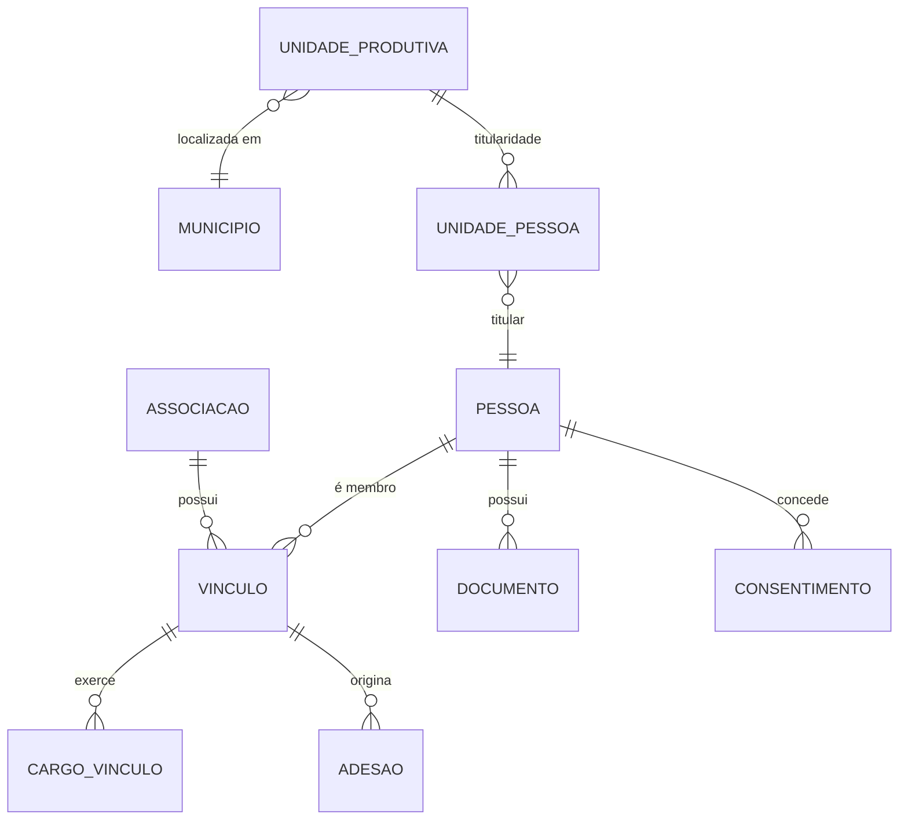

# Arquitetura — App de Gestão de Agricultores e Produtores Associados

> **Escopo:** desenho do contexto **D1 — Quadro Associativo** (cadastro, vínculo, adesão, histórico e
> ciclo de vida do agricultor/produtor), com um modelo de dados que precisa sobreviver a uma
> integração com outro app.
>
> **Premissas de alinhamento com o plano vigente** (`docs/v5/PLANO-DE-MODULOS-E-EXECUCAO.md`):
> este documento **concretiza** o D1 dentro das regras já aprovadas — as cinco leis do §4.4, o
> ownership de tabelas do §4.7, as convenções de API do §4.6 e o contrato `AssociadoRef` do §4.3.
> O `PLANO_MIGRACAO_NODE.md` está classificado como **obsoleto** (PLANO:1144); a decisão de
> linguagem segue em aberto e **não muda o desenho do banco** — é isso que garante a integração.

---

## 0. Diagnóstico do que existe hoje (por que o modelo atual não serve de contrato)

Levantado no banco `sisagro` (31 associados, 16 propriedades, 2.404 linhas de auditoria, 120
tabelas) e nos relatórios de módulo:

| Evidência | Onde | Por que é problema para integração |
|---|---|---|
| `associados` tem **mais de 50 colunas** e acumula 9 papéis: identidade civil, contato, autenticação (`senha`/`nivel`/`tipo`), vínculo, certificação, ficha, território, notificações e integração | `associados` | "Associado" não é uma coisa só: é pessoa + vínculo + usuário. O consumidor externo não sabe o que replicar. |
| `usuarios` duplica nome, CPF, endereço, telefone, `nivel`, `tipo` e ainda guarda `associado_id`; há duas identidades paralelas (staff e agricultor) | `usuarios` × `associados`; REL:51-52, 558-559 | Duas fontes para o mesmo dado civil → divergência. Pior: `usuarios.nivel DEFAULT 1` cria **Admin** quando o INSERT esquece o nível (REL:558). |
| `associados/cadastrar.php` insere em `associados` **e** `usuarios` com `status='ativo'` | REL:17, 559 | A pessoa consegue logar **antes** de qualquer aprovação. Regra de negócio ausente no modelo. |
| `associados.associacao_id` está **NULL em 31/31**, mas existem 24 vínculos em `associado_associacao` | banco | Coluna redundante já divergente: a verdade está na junção. FK nullable usada como vínculo é armadilha. |
| Três representações de vínculo: `associados.vinculo`, `associados.associacao_id` e `associado_associacao`; `AssociadoAssociacao::save` não grava `tipo_vinculo` | REL:376-382 | Não existe "o" vínculo — e um deles perde dado ao salvar. |
| `associado_associacao` só tem `data_vinculo`, sem `data_fim`/motivo; `tipo_vinculo` mistura 9 cargos de diretoria | REL:53-54 | Vínculo não é temporal → impossível responder "quem era associado em 2024" ou auditar desligamento. |
| `ficha_adesao` repete ~60 colunas de `associados` e é a **única** casa do dado da propriedade (áreas, situação fundiária, geo, banco, PIX); `associado_id` é nullable e `usuario_id` é UNIQUE | `ficha_adesao`; REL:55 | Ficha é *documento*, não cadastro. O dado produtivo não tem entidade própria, e a ficha virou cadastro paralelo. |
| `status ENUM('ativo','inativo','pendente')` **e** `status_associado ENUM('Ativo','Inadimplente','Afastado','Desligado','Falecido')` | `associados`; REL:51 | Status cadastral e financeiro no mesmo lugar; ENUM com maiúscula/acento é contrato frágil. O `AssociadoRef` já pressupõe `pendente|ativo|inativo|desligado` — hoje não há projeção garantida. |
| `SET('horticultura',...)` para sistemas de produção e `SET` de canais | `ficha_adesao` | `SET` não é integrável: adicionar item exige `ALTER TABLE`, sem catálogo e sem N:N. |
| `propriedades` tem colunas legadas `nome`, `localizacao`, `tamanho`, `status`, `recursos_naturais` **100% NULL**; `latitude/longitude` são `VARCHAR`; `cidade`/`estado` são texto sem FK | `propriedades`; REL:16, 556-557 | Schema morto + geo não consultável + território textual (a mesma coluna guarda id, UF e nome de município). |
| `carteirinhas` sem FK, sem histórico; `gerar()` sobrescreve o token na mesma linha | REL:56, 455 | QR antigo deixa de validar; nenhum evento de emissão/revogação. |
| `uuid` existe em **13 tabelas**; `atualizado_em` em **5** poucas | PLANO:528-529 | O contrato público (`uuid` em URL) só é sustentável se toda entidade do contexto tiver as duas colunas. |
| Soft-delete em duas convenções (`excluido TINYINT` em 24 tabelas, `excluido_em` em 2); exclusão de associado é DELETE físico que deixa órfãos | banco; REL:133 | Impossível sincronizar por delta ou apagar de forma auditável. |
| `audit_log` registra **ação** (`LOGIN`, `FICHA_ADESAO_SUBMETIDA`), não *mudança de campo* | `audit_log` | Não há trilha "quem alterou o quê" — consumidor não consegue reconciliar. |
| CPF em texto puro e exposto em `v_associados_resumo`; rota pública de carteirinha expõe nome/foto/nascimento e envia token a `api.qrserver.com` | PLANO:272; REL:21, 469, 478 | LGPD: dado sensível legível por qualquer `SELECT` e vazando para terceiro. |
| `eventos` é outbox do K3 **e** tabela de eventos do D8 | PLANO:512, 520 | Exemplo do que a matriz de ownership precisa resolver antes de integrar. |

**Conclusão:** o banco atual é uma boa **fonte de dados** e um mau **contrato**. O desenho abaixo
separa o núcleo estável (pessoa, vínculo, adesão, documento) do detalhe de tela — e projeta o
contrato `AssociadoRef` a partir do núcleo, não de colunas soltas.

---

## 1. Decisões de arquitetura (ADRs resumidos)

| # | Decisão | Alternativa descartada | Motivo |
|---|---|---|---|
| A1 | **Monólito modular** com D1 isolado por diretório + `deptrac` | microsserviço separado | 31 produtores hoje; a fronteira é de *código e schema*, não de infraestrutura. |
| A2 | **Um único dono por tabela**, como já definido em PLANO §4.7 | banco "compartilhado" onde todos escrevem | Escrita cruzada é a origem nº 1 de corrupção em integração por banco. |
| A3 | Chave pública **UUIDv7** + `BIGINT` interno, em toda entidade do contexto | expor auto-increment | UUID não colide entre apps e não vaza volume; v7 preserva localidade de índice. |
| A4 | Separar **`pessoa`** (D1) de **credencial** (K1) | manter `senha`/`nivel` em `associados` | Lei 3 do PLANO: credenciais vivem no K1. |
| A5 | **Vínculo temporal** (`data_entrada`, `data_saida`, `motivo`), histórico append-only | sobrescrever status | Auditoria, relatório de diretoria, integração e desligamento. |
| A6 | **`adesao` é documento** (snapshot JSON imutável + status), não cadastro | continuar duplicando 60 colunas | Ficha vira prova do que foi declarado; dado aprovado é promovido ao núcleo. |
| A7 | Unidade produtiva **pertence ao D2**; D1 referencia por `UnidadeProdutivaRef` (já existe no Kernel) | D1 passar a ser dona de `propriedades` | Respeita PLANO §4.7. Se o negócio exigir outra fronteira, registrar ADR — não mover silenciosamente. |
| A8 | Catálogos (`tipo_associado`, `motivo_saida`, `sistema_producao`…), não `ENUM`/`SET` extensível | manter `SET` da ficha | Extensão sem migration e vocabulário estável (`codigo`) para o outro app. |
| A9 | **`change_log` monotônico + outbox** na mesma transação | "o outro app compara as tabelas" | Delta sync confiável, replay e offline-first (PLANO §4.5 já prevê outbox). |
| A10 | Integração em **3 níveis**: views read-only, API `/api/v1`, eventos | só banco | Cada consumidor escolhe o acoplamento que aguenta; escrita só via API. |
| A11 | **CPF cifrado + hash HMAC**; mascaramento por padrão | CPF claro + índice único | LGPD e unicidade sem armazenar claro (PLANO §4.3 já exige `cpfMascarado`). |
| A12 | Migração **strangler/expand-contract**, `associados` vira *projeção* de compatibilidade | reescrever as tabelas no legado | Congelamento de features ativo; nenhuma tela pode quebrar. |

---

## 2. Escopo e fronteiras

### 2.1 D1 é dono

- `pessoa` — dado civil (PF/PJ), documentos de identidade, contato, endereço, consentimentos.
- `vinculo_associado` — pessoa × associação: matrícula, tipo, situação cadastral, período, motivo.
- `cargo_vinculo` — mandato (presidente, tesoureiro, conselho) com período próprio.
- `adesao` — ficha submetida (snapshot + status + parecer + aceite).
- `historico` / `auditoria` de alteração — quem mudou o quê, quando, com qual `request_id`.
- `change_log` do contexto (o transporte pode ser do K3; o fato é do D1).

### 2.2 D1 consome por referência (nunca por coluna alheia)

| Dado | Dono | Como D1 usa |
|---|---|---|
| Credencial, papel, sessão | K1 | `usuario_uuid` / `pessoa_uuid`; nunca `senha` |
| Município, microrregião, IBGE | K2 | `municipio_id` + `codigo_ibge` em cache local |
| Propriedade, lavoura, lote | D2 | `UnidadeProdutivaRef` (`tipo`,`uuid`,`rotulo`) |
| Mensalidade, pagamento | D4 | recebe evento; **não** guarda inadimplência no vínculo |
| Visita, certificado, não conformidade | D3 | referencia `pessoa_uuid` |
| `audit_log` / outbox / arquivos | K3 | usa a interface; não escreve direto |

Regra: se a informação é de outro dono, D1 guarda **referência opaca (`uuid`)** ou projeta um
**read model** atualizado por evento — nunca faz `JOIN` (lei 1) nem `UPDATE` (lei 2).

---

## 3. Modelo de dados canônico

### 3.1 ERD



> `UNIDADE_PRODUTIVA`/`UNIDADE_PESSOA` são do **D2** (referência), não do D1.

### 3.2 Núcleo D1 (DDL resumido — validado no MariaDB 10.4.32 atual; compatível com 10.11 LTS)

```sql
-- Pessoa: existe sem ser associada (técnico, fiscal, dirigente, PJ fornecedora).
CREATE TABLE pessoa (
  id             BIGINT UNSIGNED NOT NULL AUTO_INCREMENT PRIMARY KEY,
  uuid           CHAR(36)  NOT NULL,
  tipo           CHAR(2)   NOT NULL,               -- PF | PJ
  nome           VARCHAR(150) NOT NULL,
  nome_social    VARCHAR(150) NULL,
  data_nascimento DATE NULL,
  cpf_cifrado    VARBINARY(255) NULL,              -- AES-256-GCM (chave fora do banco)
  cpf_hash       BINARY(32) NULL,                  -- HMAC-SHA256(pepper, 11 dígitos)
  cpf_final      CHAR(2)   NULL,                   -- últimos 2 dígitos, p/ mascarar sem decifrar
  cnpj_hash      BINARY(32) NULL,
  email          VARCHAR(190) NULL,                -- normalizado (lowercase)
  telefone       VARCHAR(20)  NULL,                -- E.164
  municipio_id   INT UNSIGNED NULL,                -- K2
  zona           CHAR(1) NULL,                     -- R | U | P
  criado_em      DATETIME(6) NOT NULL DEFAULT CURRENT_TIMESTAMP(6),
  atualizado_em  DATETIME(6) NOT NULL DEFAULT CURRENT_TIMESTAMP(6) ON UPDATE CURRENT_TIMESTAMP(6),
  versao         INT UNSIGNED NOT NULL DEFAULT 1,
  anonimizada_em DATETIME(6) NULL,                 -- LGPD art. 18
  UNIQUE KEY uk_pessoa_uuid (uuid),
  UNIQUE KEY uk_pessoa_cpf  (cpf_hash),
  UNIQUE KEY uk_pessoa_cnpj (cnpj_hash),
  KEY idx_pessoa_nome (nome),
  CONSTRAINT fk_pessoa_municipio FOREIGN KEY (municipio_id) REFERENCES cidades(id)
);

-- Vínculo: a peça central. Temporal, com histórico.
CREATE TABLE vinculo_associado (
  id             BIGINT UNSIGNED NOT NULL AUTO_INCREMENT PRIMARY KEY,
  uuid           CHAR(36) NOT NULL,
  associacao_id  INT UNSIGNED NOT NULL,
  pessoa_id      BIGINT UNSIGNED NOT NULL,
  numero_associado VARCHAR(20) NULL,               -- matrícula legível (hoje AAES-#####)
  tipo_associado_id INT UNSIGNED NOT NULL,         -- catálogo
  situacao       ENUM('pendente','ativo','inativo','desligado') NOT NULL, -- = contrato AssociadoRef
  data_entrada   DATE NOT NULL,
  data_saida     DATE NULL,
  motivo_saida_id INT UNSIGNED NULL,
  aprovado_por   BIGINT UNSIGNED NULL,              -- pessoa_id de quem aprovou
  aprovado_em    DATETIME(6) NULL,
  -- "um vínculo vigente por pessoa+associação" sem índice parcial (truque MariaDB):
  vigente        TINYINT GENERATED ALWAYS AS (IF(data_saida IS NULL, 1, NULL)) STORED,
  criado_em      DATETIME(6) NOT NULL DEFAULT CURRENT_TIMESTAMP(6),
  atualizado_em  DATETIME(6) NOT NULL DEFAULT CURRENT_TIMESTAMP(6) ON UPDATE CURRENT_TIMESTAMP(6),
  versao         INT UNSIGNED NOT NULL DEFAULT 1,
  UNIQUE KEY uk_vinculo_uuid (uuid),
  UNIQUE KEY uk_vinculo_matricula (associacao_id, numero_associado),
  UNIQUE KEY uk_vinculo_vigente (associacao_id, pessoa_id, vigente),
  KEY idx_vinculo_pessoa (pessoa_id),
  CONSTRAINT fk_vinculo_assoc  FOREIGN KEY (associacao_id) REFERENCES associacoes(id),
  CONSTRAINT fk_vinculo_pessoa FOREIGN KEY (pessoa_id) REFERENCES pessoa(id)
);
```

`cargo_vinculo(vinculo_id, cargo_id, data_inicio, data_fim)` — o cargo é do **mandato**, não do
vínculo; resolve os 9 cargos hoje espremidos em `associado_associacao.tipo_vinculo`.

`adesao` — documento, não cadastro:

```sql
CREATE TABLE adesao (
  id            BIGINT UNSIGNED NOT NULL AUTO_INCREMENT PRIMARY KEY,
  uuid          CHAR(36) NOT NULL,
  associacao_id INT UNSIGNED NOT NULL,
  pessoa_id     BIGINT UNSIGNED NULL,              -- pedido de acesso pode chegar sem pessoa
  status        ENUM('rascunho','pendente','aprovada','recusada') NOT NULL,
  payload_json  JSON NOT NULL,                     -- snapshot do que foi declarado (imutável)
  numero_cadastro VARCHAR(20) NULL,
  data_submissao DATETIME(6) NULL,
  analisado_por  BIGINT UNSIGNED NULL,
  analisado_em   DATETIME(6) NULL,
  parecer        TEXT NULL,
  criado_em      DATETIME(6) NOT NULL DEFAULT CURRENT_TIMESTAMP(6),
  UNIQUE KEY uk_adesao_uuid (uuid)
);
```

O que hoje são ~60 colunas na `ficha_adesao` vira: campos **indexáveis** (status, data, parecer) +
`payload_json` íntegro. A aprovação **promove** os dados para `pessoa`, `vinculo_associado` e
dispara a criação da unidade produtiva no D2 (por evento/comando), com `associado.aprovado`.

### 3.3 Projeções do contrato (o que o outro app consome)

O `AssociadoRef` do Kernel é o **contrato publicado**. Ele deve ser servido por uma view/projeção,
não por adivinhação do consumidor:

```sql
CREATE VIEW v_associado_ref AS
SELECT p.uuid,
       CONCAT(p.nome, IFNULL(CONCAT(' ', p.nome_social), '')) AS nome_exibicao,
       CONCAT('***.***.***-', IFNULL(p.cpf_final, '**')) AS cpf_mascarado,
       v.situacao AS status,
       v.numero_associado,
       a.uuid AS associacao_uuid,          -- nunca o id interno
       p.municipio_id,
       GREATEST(p.atualizado_em, v.atualizado_em) AS atualizado_em
FROM pessoa p
JOIN vinculo_associado v ON v.pessoa_id = p.id AND v.data_saida IS NULL
JOIN associacoes a       ON a.id = v.associacao_id;
```

Estados de negócio que o contrato não tem (`afastado`, `falecido`, `inadimplente`) são
**representados sem quebrar `kernel@1`**: `afastado`→`inativo` + `motivo_saida`; `falecido`→
`desligado` + motivo; `inadimplente` é **do D4** e chega por evento, nunca no `status` do cadastro.

### 3.4 Catálogos e território

`tipo_associado`, `cargo`, `motivo_saida`, `situacao_fundiaria`, `tipo_documento`,
`sistema_producao`, `canal_comercial` — `id`, `codigo` (slug `UNIQUE`), `nome`, `ativo`, `ordem`.
**O `codigo` é o valor semântico que o outro app usa; o `id` interno não vaza.** Município usa
`codigo_ibge` como chave natural (K2).

### 3.5 Máquina de estados

```
ADESAO:    rascunho ──▶ pendente ──▶ aprovada
                         └─────────▶ recusada ──▶ (nova submissão)
VINCULO:   pendente ──▶ ativo ⇄ inativo ──▶ desligado (terminal)
PESSOA:    ativa ──▶ anonimizada (LGPD, terminal)
```

Invariantes no domínio (não na tela):

1. CPF único via `cpf_hash`, válido; PJ usa CNPJ.
2. Um vínculo vigente por `(associacao, pessoa)` (uk gerado).
3. `data_saida ≥ data_entrada`; desligamento exige motivo e não pode haver adesão pendente.
4. Aprovação exige consentimento vigente e ao menos uma unidade produtiva quando o tipo exigir.
5. Ninguém loga como associado antes da aprovação (hoje é possível — REL:17, 559).
6. Desligar **não apaga**: fecha o vínculo, mantém histórico e financeiro.
7. `situacao` cadastral ≠ situação financeira.

---

## 4. Estrutura do código

```
src/Modules/Associados/                  (D1, hoje tem só Controller + Repository)
├── Domain/                              # regras puras, sem PDO/HTTP
│   ├── Pessoa/                          Pessoa, Cpf, Cnpj, Nome, Email(vo), PessoaRepository
│   ├── Vinculo/                         VinculoAssociado, Periodo, MotivoSaida, eventos
│   ├── Adesao/                          Adesao, TransicaoStatus
│   └── Shared/                          Uuid, Periodo, DomainEvent
├── Application/                         # 1 classe = 1 intenção do negócio
│   ├── CadastrarPessoa.php
│   ├── MatricularAssociado.php          (cria vínculo pendente + adesão)
│   ├── AprovarAdesao.php                (promove dados, publica associado.aprovado)
│   ├── AtualizarCadastro.php
│   ├── EncerrarVinculo.php
│   ├── RegistrarConsentimento.php
│   ├── ConsultarAssociado.php           (query, usa read model)
│   └── Ports/                           EventPublisher, Clock, CpfHasher, FileStorage
├── Infrastructure/
│   ├── Persistence/                     PdoPessoaRepository, PdoVinculoRepository, OutboxRepository
│   ├── Integration/                     ChangeLogWriter, OutboxDispatcher, CompatProjection
│   └── Security/                        CpfCipher, CpfHasher, RbacPolicy
├── Http/                                AssociadosController (evolui), Dto/ gerado do OpenAPI
└── Migrations/                          versionadas e idempotentes (aditivas)
```

Dependências: `Http → Application → Domain`; `Infrastructure` implementa portas. `deptrac` já
existe no repo (`deptrac.yaml`) e deve cobrir "controller sem SQL", como no PLANO §4.4.

### 4.1 Fluxo de escrita

```
HTTP → Controller (forma) → Use case (regra + transação)
     → Repositório (SQL) + change_log + outbox   [mesma transação]
     → resposta (uuid, versao, ETag)
     → worker publica outbox → webhook/fila → outro app
```

O caso de uso calcula `versao` (optimistic lock). Duas edições concorrentes: a segunda recebe
`409 CONFLITO` com a versão atual — em vez de sobrescrever silenciosamente (hoje `gerar()` da
carteirinha faz exatamente isso).

---

## 5. Contrato de API

Adotar **exatamente** as convenções do PLANO §4.6 (não criar um dialeto novo):

| Item | Decisão |
|---|---|
| Prefixo | `/api/v1` |
| Formato | JSON `application/json; charset=utf-8`; upload `multipart/form-data` |
| Autenticação | sessão PHP (cookie `HttpOnly`/`SameSite=Lax`) na web/PWA; token para nativo; **client credentials** para o outro app |
| CSRF | token por sessão em `POST/PATCH/DELETE` |
| IDs | **`uuid` em URL**, nunca id sequencial |
| Dinheiro | inteiro em **centavos** |
| Datas | ISO-8601 com fuso |
| Paginação | `?page=&perPage=` + envelope `meta` |
| Erros | `{error:{code,message,details,requestId}}` |
| Idempotência | `Idempotency-Key` em sync e webhooks |
| Correlação | `X-Request-Id` em log e resposta |
| Docs | OpenAPI 3.1 gerado dos contratos, versionado em `docs/api/` |

Recursos do contexto:

```
POST /api/v1/associacoes/{uuid}/adesoes                 (Idempotency-Key)
GET  /api/v1/associados?page=&perPage=&situacao=&q=
GET  /api/v1/associados/{uuid}                          (ETag/If-None-Match — extensão aditiva)
PATCH /api/v1/associados/{uuid}                         (If-Match — extensão aditiva)
POST /api/v1/associados/{uuid}/aprovacao                 → promove adesão
POST /api/v1/associados/{uuid}/desligamento
GET  /api/v1/associados/{uuid}/historico
POST /api/v1/associados/{uuid}/consentimentos
GET  /api/v1/associados/{uuid}/exportacao                (LGPD — dados do titular)
POST /api/v1/associados/{uuid}/anonimizacao
GET  /api/v1/sync?since=<seq>&limit=500                  (delta p/ integração e offline)
```

`ETag`/`If-Match` não estão no plano: entram como **extensão compatível** (header opcional) e
exigem ADR. `/sync` é o "pull incremental" já previsto no PLANO §5.5.

---

## 6. Integração com outro app — o desenho central

O banco **será reutilizado**, então ele precisa ser contrato explícito, não detalhe de tela.

### 6.1 Três níveis de acoplamento (use o mais frouxo que resolve)

| Nível | Mecanismo | Uso típico | Garantia |
|---|---|---|---|
| **L0 — leitura por banco** | schema `assoc_pub`: views **somente-leitura**; usuário MySQL `app_reader` com `SELECT` só nelas | BI, dashboards, outro app que só lê | simples; sem escrita cruzada |
| **L1 — API** | REST `/api/v1` (OpenAPI) | leitura em tempo real e **toda escrita** | validação, autorização, auditoria |
| **L2 — eventos** | outbox → fila/webhook, at-least-once + dedupe | reagir a aprovação/desligamento sem *polling* | desacoplamento temporal |

**Regra dura:** o outro app **nunca** faz `INSERT/UPDATE` em tabela do D1. Se precisar escrever,
é dono da tabela dele e referencia `pessoa_uuid` — ou consome um endpoint.

### 6.2 `change_log` — o contrato que resolve delta sync, offline e integração

```sql
CREATE TABLE change_log (
  seq           BIGINT UNSIGNED NOT NULL AUTO_INCREMENT PRIMARY KEY,
  entidade      VARCHAR(40)  NOT NULL,   -- pessoa | vinculo | adesao
  entidade_uuid CHAR(36)     NOT NULL,
  operacao      ENUM('I','U','D') NOT NULL,
  versao        INT UNSIGNED NOT NULL,
  ocorrido_em   DATETIME(6)  NOT NULL DEFAULT CURRENT_TIMESTAMP(6),
  request_id    CHAR(36)     NULL,
  KEY idx_change_entidade (entidade, seq)
) ENGINE=InnoDB;
```

- Escrita na **mesma transação** do agregado (padrão outbox do PLANO §4.5).
- Consumidor guarda o último `seq`: `WHERE seq > :cursor ORDER BY seq LIMIT :n`.
- `DELETE` vira tombstone (`operacao='D'`) — o offline-first precisa saber que algo sumiu.
- Gaps de `AUTO_INCREMENT` por rollback são normais: cursor monotônico **tolera buracos**. Para
  leitura, o `since` máximo usa janela de estabilização (`ocorrido_em < UTC_TIMESTAMP(6) - 1s`)
  para não pular transação longa que commita depois.

### 6.3 Eventos (L2)

Envelope versionado, sem dado sensível, alinhado ao catálogo do PLANO (§4.5):

```json
{
  "event_id": "0193f2...",
  "type": "associado.aprovado",
  "version": "1.0",
  "occurred_at": "2026-11-11T15:04:05.123Z",
  "associacao": { "uuid": "..." },
  "aggregate": { "type": "vinculo", "uuid": "...", "versao": 4 },
  "data": { "pessoa_uuid": "...", "numero_associado": "AAES-0412",
            "situacao": "ativo", "data_entrada": "2026-11-11" },
  "trace_id": "..."
}
```

Catálogo do D1: `associado.aprovado`, `associado.status_alterado`, `vinculo.alterado` (já no
plano) + `adesao.submetida`, `vinculo.encerrado`, `documento.anexado`, `consentimento.revogado`.

Regras: `type` + `version` estáveis; campo só sai em major; consumidor **deduplica por
`event_id`**; entrega at-least-once; `GET /eventos?since=` permite *replay*.

### 6.4 Reconciliação e chaves externas

```sql
CREATE TABLE integracao_ref (
  sistema       VARCHAR(40) NOT NULL,   -- ex.: 'app_cooperativa'
  entidade      VARCHAR(40) NOT NULL,
  entidade_uuid CHAR(36)    NOT NULL,
  id_externo    VARCHAR(120) NOT NULL,
  sincronizado_em DATETIME(6) NOT NULL,
  PRIMARY KEY (sistema, entidade, id_externo),
  UNIQUE KEY uk_ref_local (sistema, entidade, entidade_uuid)
);
```

Evita duplicar agricultor quando o outro app já o conhece por ID próprio (ex.: nº de sócio do
sistema antigo). Job noturno confere contagem + checksum por entidade.

---

## 7. Segurança e LGPD (requisito de schema, não anexo)

1. **CPF nunca em texto**: `cpf_cifrado` (AES-256-GCM, chave fora do banco) + `cpf_hash`
   (HMAC-SHA256 com *pepper*) para unicidade e busca exata. `v_associados_resumo` (que expõe CPF)
   é substituída por view mascarada.
2. **Mascaramento por padrão**: API devolve `***.***.***-XX` (contrato `AssociadoRef` já exige);
   revelar exige capability + motivo + registro de leitura.
3. **Consentimento versionado**: `consentimento(finalidade, base_legal, versao_termo,
   concedido_em, revogado_em, ip, evidencia)` — `aceite_termos` booleano não sustenta auditoria.
4. **Auditoria por campo**: complementar o `audit_log` (que só registra ação) com
   `campos_alterados JSON` + `request_id`.
5. **Escopo por associação** row-level (como já feito em D3) + testes de IDOR; multi-certificadora
   segue pendência aberta (ONDA2) — não bloquear o D1, mas prever `associacao_id` em toda entidade.
6. **Minimização**: evento e view nunca carregam CPF/endereço/e-mail completos; exportação LGPD é
   endpoint autenticado com trilha própria; parar de mandar token para `api.qrserver.com`.
7. **Anonimização** preserva integridade referencial: `pessoa.anonimizada_em` + *scrub*, mantendo
   `uuid`, vínculo e estatística.

---

## 8. Migração do banco atual (strangler, sem quebrar o legado)

| Atual | Novo | Estratégia |
|---|---|---|
| `associados` (dado civil) | `pessoa` | backfill por `uuid`; **manter `pessoa.id = associados.id`** para as FKs do legado continuarem válidas |
| `associados` (vínculo/status) | `vinculo_associado` + `cargo_vinculo` | derivar de `associado_associacao`; ignorar `associados.associacao_id` (NULL em 31/31) |
| `associados` (senha/nivel) | K1 | extrair para credencial; `usuarios` perde os campos civis |
| `ficha_adesao` | `adesao` (payload JSON) + promoção | a ficha deixa de ser cadastro; aprovação promove para `pessoa`/`vinculo` e avisa o D2 |
| `ficha_adesao_produtos` | `adesao.payload_json` / catálogo do D2 | normalizar |
| `associado_associacao` | `vinculo_associado` | adicionar `data_saida`/motivo; `tipo_vinculo`→`cargo_vinculo` |
| `propriedades` | D2 (referência) | D1 só guarda `unidade_uuid`; geo vira `DECIMAL` no D2 |
| `v_associados_resumo` | `v_associado_ref` (mascarada) | manter a antiga durante a transição |
| `audit_log` | `auditoria` (campo a campo) | histórico antigo preservado; novo formato só para novos fatos |

Sequência:

1. **Fase A — saneamento aditivo**: catálogos, `change_log`, `outbox`; `updated_at`/`uuid` nas
   tabelas do contexto; normalizar soft-delete; corrigir `usuarios.nivel DEFAULT 1` e o cadastro
   que ativa login antes da aprovação.
2. **Fase B — build paralelo**: migrações + backfill idempotente com relatório de reconciliação
   (contagens, órfãos, CPF inválido/duplicado, `uuid` ausente).
3. **Fase C — projeção de compatibilidade**: `associados` passa a ser **read model** mantido na
   mesma transação (mantendo `id`), verificado por job de conferência. Legado segue lendo
   `associados`; D1 escreve no núcleo.
4. **Fase D — cut-over por tela**: as telas do módulo passam ao novo repositório uma a uma
   (refatoração permitida mesmo no congelamento — não é feature nova).
5. **Fase E — contract**: legado lê só `v_*` de compatibilidade; remove-se a projeção e, depois de
   um ciclo, as colunas mortas.

> Não fazer escrita dupla em dois sentidos: a projeção é **unidirecional** (núcleo → legado) e
> verificável. Se o legado ainda escrever em `associados`, ele escreve em tabela de **projeção**,
> não na fonte da verdade — com ADR explícito de exceção.

---

## 9. Testes e critérios de aceite

| Nível | O que prova |
|---|---|
| Domínio | invariantes 1–7 da §3.5 e transições válidas/inválidas |
| Persistência | CPF duplicado em concorrência → 1 sucesso + 1 `CONFLITO`; `uk_vinculo_vigente` |
| Contrato | `v_associado_ref` projeta exatamente `AssociadoRef` (`uuid`, `status`, `cpfMascarado`, `atualizadoEm`); snapshot das colunas versionado no Git |
| Integração | outbox entregue ≥1× com dedupe por `event_id`; `/sync` sem perda (cursor monotônico) |
| Segurança | IDOR por associação; CPF mascarado por padrão; reveal auditado |
| LGPD | exportação completa do titular; anonimização sem quebrar FK |
| Carga | 10 k associados / 50 k unidades: lista paginada p95 < 300 ms |

Pronto quando: (a) toda entidade do contexto tem `uuid` + `versao` + `atualizado_em`; (b) nenhum
payload/evento carrega `id` interno; (c) nenhum `ENUM`/`SET` de domínio extensível; (d) todo write
gera `change_log`; (e) consumidor sincroniza só por `/sync`/`change_log`.

---

## 10. Roadmap sugerido (8 semanas)

| Semana | Entrega |
|---|---|
| 1 | ADRs, DDL canônico, catálogos, `change_log`/`outbox`, OpenAPI esqueleto |
| 2–3 | `pessoa` + `vinculo_associado`: cadastro, matrícula, aprovação, desligamento + testes |
| 4 | `adesao` como documento, consentimento, histórico/auditoria por campo |
| 5 | API v1 completa (convenções §5, idempotência, scopes) + auth |
| 6 | `v_associado_ref`, `/sync`, dispatcher de outbox, webhook, `integracao_ref` |
| 7 | Backfill + projeção de compatibilidade + reconciliação + corte de telas |
| 8 | Carga, IDOR, LGPD, observabilidade, runbook, remoção da escrita legada |

---

## 11. O que **não** fazer

1. Tabela única com 50+ colunas misturando pessoa, login, vínculo e território.
2. `SET`/`ENUM` para domínio que o negócio estende (sistemas de produção, canais).
3. Expor `id` auto-increment em API/evento — obriga o consumidor a acoplar no banco.
4. Status financeiro dentro do cadastro (`Inadimplente` como status do associado).
5. Soft-delete em duas convenções e sem `updated_at` — mata delta sync.
6. CPF em texto puro, view pública com CPF, token em QR de terceiro.
7. Deixar o outro app escrever nas tabelas do D1.
8. Duplicar pessoa em `usuarios` e sincronizar na mão.
9. FK nullable usada como vínculo convivendo com tabela de junção.
10. Sincronizar "copiando a tabela" sem `change_log`/cursor — caminho mais rápido para
    perder/duplicar produtor.

---

## 12. Pontos que dependem de decisão do cliente/arquiteto

1. **Unidade produtiva** continua no D2 (recomendado, respeita o plano) ou passa para o D1 como
   "cadastro do produtor"? Muda o ownership e o caminho do dado da ficha.
2. **O outro app lê ou escreve?** Se escreve, qual entidade e por qual nível (L0/L1/L2)?
3. **Multi-associação / multi-certificadora** desde já? Isso decide se `associacao_id` é obrigatório
   e se as views filtram por tenant.
4. **Reescrita (NestJS/Prisma) ou evolução PHP `/api/v1`?** O modelo deste documento é o mesmo; o
   que muda é a camada de código e a ferramenta de migração (Prisma Migrate vs scripts idempotentes).
